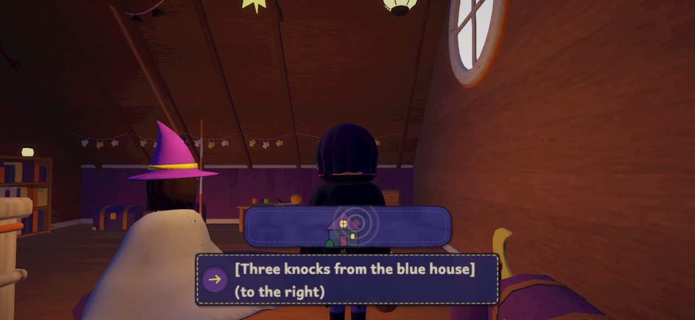
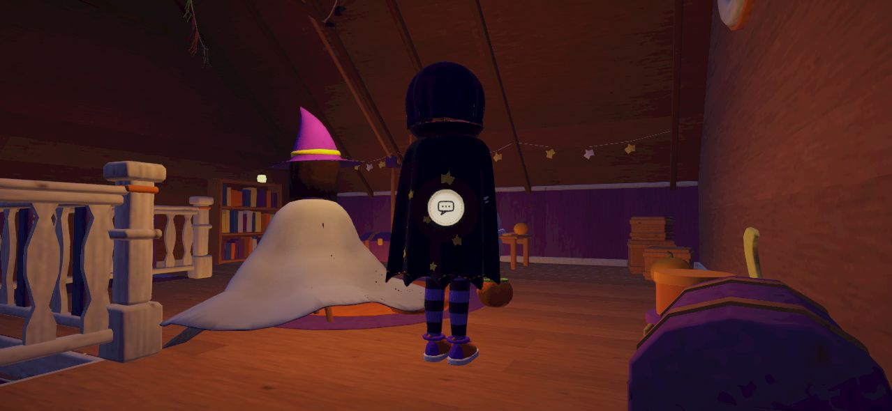
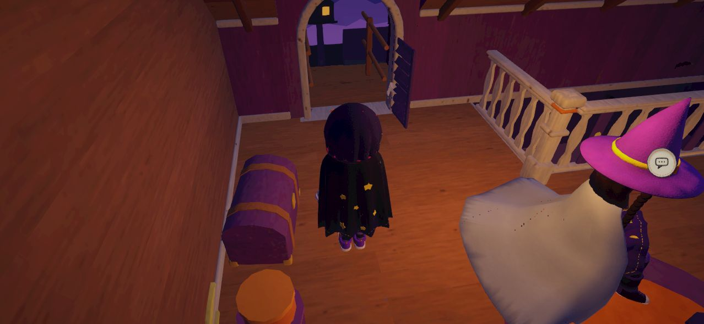
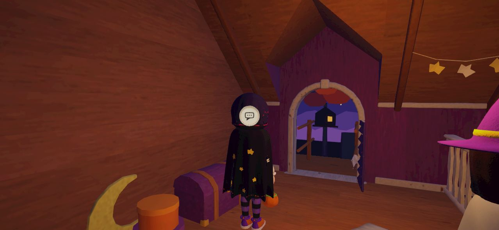

# S002 fix: attic framing, a gentler safety net, the knocks heard indoors

Branch `fix/attic-framing` (from `main` ceaf6fb, after `fix/dormer-stuck`). Follows
[S002-dormer-stuck](S002-dormer-stuck.md), [S002-interior-polish](S002-interior-polish.md) and
[S002-house-v3-wiring](S002-house-v3-wiring.md). Governing decisions: D24 (enterable spaces: Pip and the room,
no architecture filling the frame), D26 (captions describe what Pip perceives), D27.

| run 101 (before) | run 110 (after) |
|---|---|
|  |  |
|  |  |

## 1. Alcove framing

### What the brown surface was

A Blender render of the shipped `OwlHouseInterior.fbx` from the run-101 lens reproduces frame 37 exactly
(`evidence/s002/attic_framing/blender_37_run101_lens.jpg`). The surface filling the right of frame 37 is not the
roof slope against the lens: it is the **front gable wall** (with the round gable window), 1.36 m to the side of a
lens that looks east along it from the alcove. A wall seen that close at a glancing angle is smeared over a third of
the frame, even though no point of it is within 0.4 m (the nearest is about 1.9 m away). Frame 39 is the same wall
from the other side: the owner's TestFlight 23 lens, 0.72 m from the gable, looking west along it.

So a "closer than 0.4 m" check alone misses both frames (it reads 0 % on each). The check that catches them counts
glancing walls too.

### The measure: `InteriorCamera.FrameCover` (Core)

- A grid of 24 × 12 screen points over the rig's 50° lens at the phone's 2.17:1 aspect. Each ray is tested
  against the closed shell (`InteriorSafety.InsideShell`: walls, roof slopes, the alcove, the openings' view boxes;
  the cabin's own walls and ceiling) and every indoor solid (the collider slabs plus the dressing without colliders).
- A ray counts when its first surface is not a floor (a top seen from above never counts) and is either
  - closer than 1.0 m (`CoverDistance`), or
  - a wall or slope closer than 3.2 m seen more than 50° off its normal (`GrazeDistance`, `GrazeDegrees`).
- `NearCover(within)` is the plain "closer than X m" share the brief asked for.
- Run 101: frame 37 **23 %**, the owner's frame 39 **32 %**; `NearCover(0.4 m)` is 0 % on both.

### The solver change

- `Solve` keeps the player's framing only when it fits **and** its cover is at most 8 % (the stair, a 1.5 m wide
  flight between walls, allows 30 %; the child-sized cabin is exempt). Otherwise every candidate (yaw swing, pitch,
  low shoulder) that could still win pays 50 points per unit of cover past the allowance. That is about 0.6 m of
  boom per 10 % of screen. Counting stops as soon as a candidate has lost, and the solver uses a coarser 12 × 6 grid.
- On open floor (no wall slab within 1.0 m, `OpenFloor`) a shot below 1.8 m pays a step, so a wall is never dodged
  by shortening the boom (D24's "bigger rooms" guarantee, `EveryStandingPlaceAndYawGetsAClearShot`).
- June's open window shutter (louvred leaf, no collider) is now a **lens-only** solid. The lens keeps out of it, but
  sightlines pass its louvres and Pip may stand against it. The first try sat the lens 0.2 m from it at the
  arrival; the Blender render showed the leaf filling the right of the frame.
- Cost: 0.9 ms a solve on average (desktop release), against 0.36 ms before. Full solves run at most every 0.15 s
  while Pip moves; the per-frame probe is unchanged.

**Result at the dormer arrival.** The lens turns 25° north and looks east-north-east into the attic, down its long
diagonal: June, the stair balustrade, the bookcase, the garlands and the back of the room. The gable is now a strip
at the right edge (`blender_37_new_lens.jpg`; run-110 frame 37: frame cover 11 %, was 23 %). Boom 1.84 m, inside
the shell, sky hidden, no caption.

### Sweep (Core, every standing place × 4 yaws, `AtticFramingTests.NoSolvedShotHasAWallFillingTheFrame`)

| room | shots | mean frame cover | over 20 % | max |
|---|---|---|---|---|
| hall | 888 | 4.1 % (run-101 solver: 13.1 %) | 24 (2.7 %; was 34 %) | 28 % (was 63 %) |
| attic | 816 | 5.2 % (9.6 %) | 6 (was 18 %) | 30 % (was 91 %) |
| alcove | 28 | 10.7 % (23.2 %) | 2 | 28 % (was 42 %) |
| stair | 68 | 21.3 % (36.9 %) | 31 | 43 % (was 62 %) |

The "was" column comes from the same measure with the cover penalty switched off, over 8 yaws. No solved lens has
more than 5 % of the screen within 0.4 m.

**In the real scene (PlayMode).**
- `InteriorFramingTests` casts the same 24 × 12 grid against every drawn interior mesh (given temporary mesh
  colliders) at 21 sample places. Run 110: 0 % within 0.4 m everywhere. Within 1.0 m: dormer arrival 4 %, landing
  12 %, upper flight 16 %, cabin up to 32 % (exempt).
- `DormerArrivalTests` checks every dormer approach at 30 and 60 fps: colliders within 0.4 m ≤ 3 % and frame cover
  ≤ 15 %.

## 2. The safety net (`InteriorRescue`)

- **Stuck only when shut in.** After 4 s of pushing in one 0.3 m spot the net now asks
  `InteriorSafety.Enclosed`. That is true when:
  - fewer than 2 of the 8 compass directions offer 0.6 m of way on (`InteriorWalkMap.EscapeRun`: walking, stepping
    up, stepping off an edge, or into a threshold's exit zone); or
  - Pip is boxed in under a stair flight (the walk map's only pockets).

  If she is free, nothing happens, and the next 4 s push is checked again (`EnclosureChecks`). Pushing into a wall,
  the trunk, the stool or the balustrade from open floor never moves her. Of 1,057 sampled floor places in the main
  area, 8 are "shut in": single-exit nooks such as the hall's south-west corner and the gaps between the attic's
  crates and the craft table. The real trap (under the stair) is still rescued.
- **Off the walkable area** is unchanged (0.75 s). It also now treats the front wall's thickness beside and above the
  doorway as not a floor: the walk map has nodes there (the hall slab runs under the wall).
- **Standing on June.** `Step` takes the characters in the room (`AddCharacter`). With Pip on June's head, or held
  on the rounded shoulder of her capsule, it returns `SlideOff` with a direction away from her axis (or toward the
  most open side). `CaseDirector` then moves Pip's CharacterController at 1.4 m/s until she drops beside June.
  This is never a teleport, and the off-walkable timer is held at 0. CI run 110 caught the shoulder case: Pip hung
  0.52 m off June's axis at 0.97 m and was teleported. `OnCharacter` now covers it, and the Core test pins it.

## 3. The knocks indoors (D26)

**Why frames 37–39 showed the caption.** The capture test performs the arrival knocks on the street and goes in by
the window less than 3.5 s later. The strip still held "[Three knocks from the blue house]", and its direction cue
was recomputed from inside the house as "(to the right)".

In normal play the knocks fire after 0.8 m of walking on the street, so the house is far away. But nothing stopped a
street sound's caption from following Pip through a threshold. The same applies to the floor hum when walking out
of the door.

**The fix:**
- `CaptionStrip.DropSounds` runs under the page at every crossing. It drops captions that carry a direction source
  (sounds heard from a place). Captions of what Pip sees are kept.
- `CaptionPerception` (Core): if the knocks first come due while Pip is already indoors (for example a save resumed
  inside), they are captioned as the **floor hum** ("[The floor shakes: knock, knock… knock]"), pointing at the
  workshop below. The story beat is unchanged: `HeardKnocks` is still gained once and raises "Where are the knocks
  coming from?". No new string; `mystery-first.md` already makes the floor hum the indoor perception of the knocks.

## Tests

- **EditMode, Core.**
  - `AtticFramingTests` (6):
    - the run-101 frames 37 and 39 measure ≥ 20 % and 30 %;
    - the arrival and the trunk spot measure ≤ 12 %;
    - the shutter is a camera solid;
    - the whole-interior sweep;
    - the indoor knock perception.
  - `InteriorSafetyTests` (21):
    - shut-in push at 30 and 60 fps;
    - 20 s pushes at six wall spots never move Pip;
    - hardly any floor place is shut in, and every pocket is;
    - sliding off June, head and shoulder.
- **PlayMode.**
  - `DormerArrivalTests`:
    - the framing and caption checks on every approach;
    - the trunk push never rescues, while the under-stair push does;
    - `StandingOnJuneSlidesPipOffBesideHer`;
    - `KnocksHeardIndoorsAreCaptionedAsTheFloorHum`.
  - `InteriorFramingTests` adds the screen-grid check and the TestFlight 23 spot.
- **Visual.** `DormerArrivalCaptureTests`:
  - 37 asserts no street knock caption and frame cover ≤ 15 %.
  - 38 is the owner's lens with the sky forced on (the historical repro).
  - 39 is now Pip in the owner's place facing west, framed by the gameplay lens (it was the owner's hard-coded
    lens).
- All fixtures call `CaseDirector.UseTemporarySaveDirectory()`.

## Evidence

- **Local.** `./tools/check-local.sh` passed (449 core tests after merging main).
- **CI run 110** (`6e9c701`, id 45089097957):
  - EditMode 473/473, including `AtticFramingTests` 6/6 and `InteriorSafetyTests` 21/21.
  - Visual 8/8.
  - PlayMode 82/83. The one failure was `StandingOnJuneSlidesPipOffBesideHer`: the shoulder case above, now fixed.
  - The log shows the under-stair `Safety net (Stuck)` rescue and the roof-plate `OffWalkable` rescue.
- **Final CI run:** see the commit after this one, and the report.

**Frames (run 110, reviewed by eye).**
- `37_dormer_arrival`:
  - Pip from behind and slightly above, in the middle of the frame. June in her witch hat is on the left by the
    stair balustrade, with the bookcase, the garlands, rafters, the craft table and boxes at the back.
  - The front gable is a strip at the right edge, with the trunk in the bottom-right corner.
  - No caption, and the sky is hidden.
- `39_tf23_sky_hidden`:
  - Pip by the trunk, facing the open dormer window with its painted yard.
  - The stair balustrade and June's hat are at the right.
  - The lens is 2.2 m back, north-east of her.

**Not run:** device or TestFlight. No device pass is claimed.

## Remaining gaps

- **Frame 39's left side.** With Pip one metre from the front gable, facing west, the gable still fills the left
  ~40 % of the frame.
  - It is a wall faced at 2–3 m, not a slab against the lens.
  - The views that avoid it would need the lens south-east of Pip, which is outside the house, or a steep 30°
    look-down from a short boom.
  - Two measures that would have made the solver prefer those (walls within 2.2–2.6 m, walls within 1.2 m of Pip)
    also penalised ordinary hall shots across the room (mean cover 10–17 %), so they were not shipped.
  - A rule tuned for "Pip right against a wall" is the next step if the owner finds this frame still heavy.
- **The stair** keeps its flight walls in view: mean cover 21 %, max 43 %. It is a 1.5 m corridor.
- **Pip clipping June's shutter.** Pip can stand overlapping June's window shutter, which has art and no collider.
  In that corner (and under the dormer's north cheek) the lens stays tight, which was already the case before.
- **Solver cost** is about 2.5× higher (0.9 ms a solve, desktop). It needs a check on the phone.
- **The KnockBeat** (the attic window light and the paper bat on the street) still plays if the knocks come due
  indoors. It is not visible from inside, and the audio pipeline is not wired yet.
- **Device:** enter by the window, look round the attic, push into the trunk, and jump onto June.
