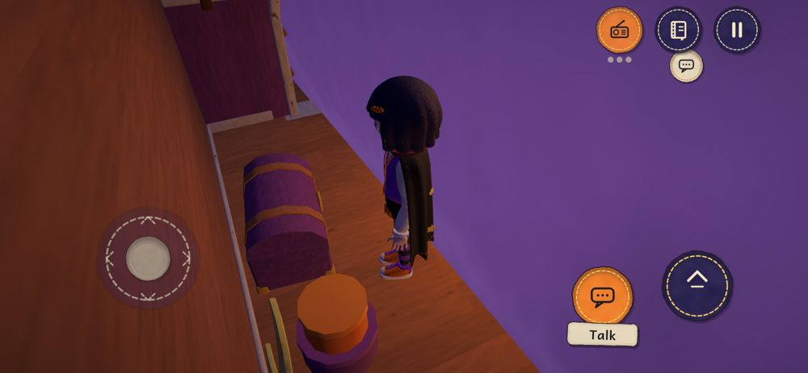
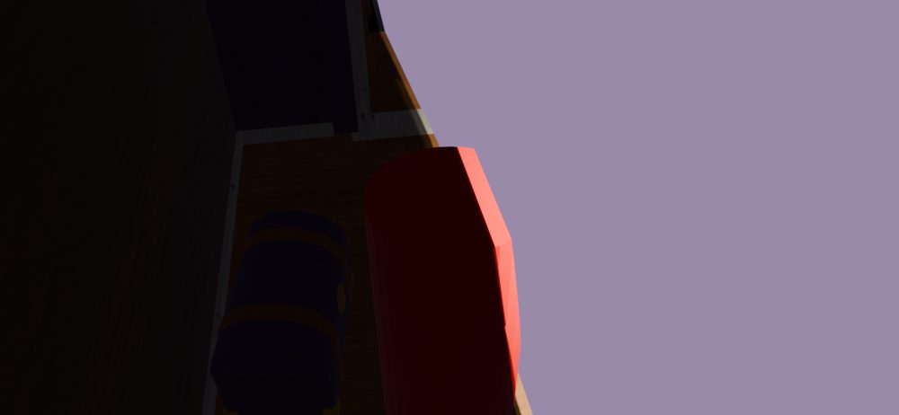
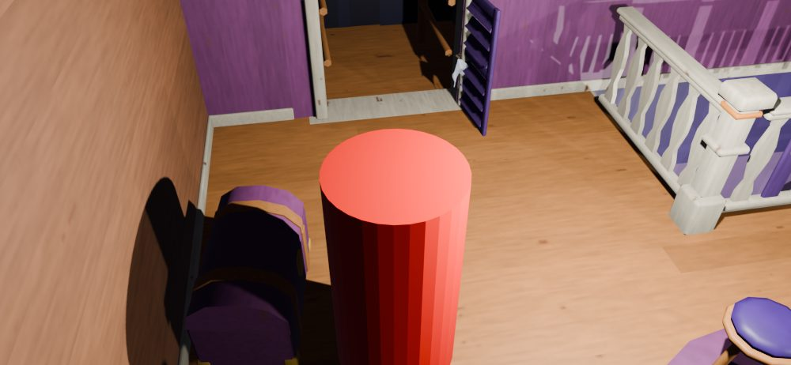

# S002 fix: stuck right after entering through the dormer (TestFlight 23)

Branch `fix/dormer-stuck` (from `main` afcb774).

> "Right after entering through the window, I got stuck in this." (owner, TestFlight build 23, iPhone)

## 1. Root cause

**The sky dome cuts through the interior.** The owl house interior (D24.1) is at z ≈ 58–65. The sky dome is a
sphere of radius 52 m centred at (0, −3, 8) (`GreyboxBuilder.BuildSkyCard`). Its shader (`SkyDome.shader`) is
opaque, writes depth and culls back faces. It stays drawn wherever the camera is.

- The dome's surface crosses the interior at about depth 1.0–1.8 (z ≈ 59.0–59.8, lower further up). The dormer
  arrival (depth 1.5) sits right on it.
- If the lens is **inside** the sphere (the south strip of the interior, near the front wall), the dome's inner face
  is drawn **in front of** everything beyond it: the rest of the attic, June, the stair rail. The device frame shows
  exactly that. A flat purple plane (the night-sky paint, HauntedPurple ≈ (91, 58, 122); the device pixels are
  ≈ (98, 62, 132)) has a straight edge. That edge runs from the window's south jamb down past Pip's feet.
- If the lens is **outside** the sphere (further north), the dome's faces are back faces and are culled. That is
  why every CI frame so far looked right: 19, 23 and 29 all had their lens north of the sphere.

The view also locates Pip. Seen from the east, high, looking west:
- The left wall is the front gable.
- The trunk and the plum-and-orange hat boxes, with the cardboard moon, are `Attic_TrunkAndHatBoxes`
  (builder x −2.3…−0.35, depth 0.25…0.78).
- The purple-and-white post at the top is the window's south jamb.

So Pip stood on open floor at about (−1.5, 4.0, depth 1.15), half a metre from the arrival point. The "narrow strip"
is the part of the attic that is still in front of the dome. Everything north of it is painted over. Walking north
looks like walking into a wall, and Pip disappears into it. Walking west (screen up) goes back out of the window.
That makes the room look like a dead end.

**The reproduction.** The Blender render below uses the shipped `OwlHouseInterior.fbx` with back-face culling, plus
a sphere with the dome's centre, radius and facing. The lens is at (0.16, 6.3, depth 0.86), inside the attic's air
and inside the dome. The left image has the dome; the right image has none. The red cylinder is Pip's capsule.

| with the dome (as shipped) | without it |
|---|---|
|  |  |

`InteriorSafetyTests.TheSkyDomeCutsThroughTheInteriorSoTheSkyIsHiddenIndoors` pins the numbers down:
- the lens is in air and inside the dome;
- June's stool is beyond it;
- part of the interior's air is on each side of the sphere.

### The hypotheses checked

1. **Arrival in a gap.** Ruled out.
   - Arrival is absolute: `ThresholdTravel.Arrive` always places Pip at (−1.7, LoftY, depth 1.5), facing +X. It does
     not depend on the approach, speed, glide or jump.
   - The new flood fill (`InteriorWalkMap`) puts that point in the main walking area. From it, Pip can walk 3 m east,
     3 m north, 1.5 m west (then the window's exit zone) and 0.44 m south (then the trunk).
2. **Collider and art mismatch, a pocket.** Ruled out for the attic.
   - The flood fill covers every slab in the interior group, at Pip's capsule size (r 0.28, h 1.1, step 0.2).
     It includes drops and jumps of up to 1.25 m.
   - It finds no place Pip can get into but not back out of, with the door latched or open.
   - The only floors it never reaches are boxed in: under the two stair flights, and the hall slab's lip under the
     front wall.
   - It first reported a "trap" on top of the hall's blanket chest. That came from the model allowing drops only to
     the next cell. Walking off the chest carries Pip past its sides, so drops now reach 0.6 m. With that, it is clear.
3. **Input left off after the wipe.** Not the cause: the HUD is up and the Talk prompt is live.
   - The wipe runs on game time with dt clamped (`Mathf.Min(dt, 0.1f)`). It is frame-rate independent, and the
     reduced-motion path is covered by `ThresholdTests`.
   - One real gap was found and fixed. A pause mid page-turn, then resume: `GameBootstrap` re-enabled gameplay input
     before the page had gone. `CaseDirector` now keeps it off until the crossing finishes.
4. **The lens outside the shell.** It was not outside: the device lens was in the attic's air.
   - But the probe's `ShortestBoom` (0.3 m) could, in principle, push the lens through a wall when Pip stands with
     her back to it.
   - The lens is now clamped to the closed shell (see the fix).

## 2. The fix

- **The sky is hidden indoors.**
  - `MagicSky.Hidden` sets `forceRenderingOff` on the dome and on every sky piece: moon, halo, clouds, bats and
    shooting star.
  - `CaseDirector` sets it each frame, and on every camera cut, from `InteriorSafety.SkyHidden`: Pip **or** the lens
    is in the interior's plan.
  - The street keeps its sky.
  - The dome's centre and radius now live in Core (`SkyModel.DomeCentre*`, `DomeRadius`, `InsideDome`), and
    `GreyboxBuilder` uses them.
  - Only the dome reaches the interior: the cloud rings (r ≤ 45 m) and the shooting stars (r 49.5 m) stay clear of
    it (`OnlyTheDomeReachesTheInteriorOfAllTheSkyPieces`).
- **The lens never leaves the shell.**
  - `InteriorSafety.InsideShell` covers the space between the inner walls, above the hall floor and under the roof
    (the alcove to its own ridge), plus the doorway and the window's reveal, which are closed by their view boxes.
  - `InteriorSafety.ShellReach` gives the longest boom that stays inside with a 0.15 m margin. That is more than
    the 0.1 m near clip.
  - `InteriorFraming` takes the smaller of the probe and the shell reach, every frame and on a cut. So the lens can
    never sit outside the shell, and the art needs no double-sided walls or backface quads.
  - The treehouse cabin is not part of the owl house shell, so it is skipped and keeps its own air and solids.
    The first CI run clamped the cabin too, and the boom collapsed into Pip.
  - A sweep of solver shots (8 yaws over the hall and attic floors) lands inside the shell with the margin
    (`EverySolvedShotIsInsideTheShell`).
- **The safety net** (`InteriorRescue`, pure Core, ticked by `CaseDirector`).
  - **Off the walkable area.** Pip is in the interior's band but either:
    - out of the shell, in the air or not; or
    - standing with no slab top under the capsule (centre or rim); or
    - standing on top of a roof plate (upstairs, the feet must be under the roof's inner faces); or
    - sunk into a solid.

    After 0.75 s, Pip is rescued.
  - **Stuck.** The stick is pushed (deflection ≥ 0.5) for 4 s without Pip leaving a 0.3 m spot. Then Pip is set down
    on the nearest safe anchor that is at least 0.75 m away.
  - Only while the player has control: no page-turn, conversation, notebook, cutaway or finale.
  - Pip is set down on the nearest of eight safe anchors (attic ×4, landing, hall ×3). Height counts double, so the
    floor Pip is on wins.
  - It cuts the camera and plays a paper dust puff where Pip was and where Pip lands (`MoveFeedback.Puff`, skipped
    with reduced motion).

## 3. Tests

- **EditMode, Core.** `InteriorSafetyTests` has 18 tests: 13 methods, 5 of them run with the door latched and open.
  - **The walk map.**
    - The hall and attic arrivals are joined on foot by the stair.
    - About 5,300 of 10,900 standing places are in the main area.
    - No trap pockets, door latched or open.
    - Every floor Pip can reach leads back to the main floors.
    - Every arrival and safe anchor is in the main area, walkable and clear of the exit zones.
    - The dormer arrival's free runs.
  - **The sky and lens rules.**
    - The bug's lens is inside the dome.
    - The sky is hidden over all interior air.
    - Every air point is inside the shell.
    - Only the dome reaches the interior.
    - Shell reach against the knee wall.
    - Every solved shot is inside the shell.
  - **The safety net.**
    - It fires at the same time at 30 and 60 fps.
    - Walking, a light touch, no control, two short pushes and the street never trigger it.
    - Off the walkable area: 0.75 s.
    - The nearest-anchor choice.
- **PlayMode.** `DormerArrivalTests` (3 tests).
  - The real motor and a gamepad stick bring Pip through June's window in five ways: walking straight, at the south
    and north side of the zone, gliding in from above the bridge, and with a held jump. This runs at 30 and 60 fps
    (`Time.captureDeltaTime`).
  - After each arrival:
    - Pip is at the arrival point on the attic floor.
    - Input is enabled.
    - The interior framing is active.
    - The lens is in the attic's air and inside the shell.
    - The sky is hidden.
    - The safety net has not fired.
  - Pip then walks from the arrival east and north for 2 m. West and south she walks as far as the attic allows: to
    0.5 m short of the window's exit zone, and to the trunk. The lens stays inside the shell every frame.
  - A second test covers two cases, and in both Pip is set down on walkable floor with a puff:
    - pushing into the trunk for about 4 s;
    - Pip standing on top of the attic's roof plate.

    A fall out of the shell is not used here. The fall return to the last safe ground (gravity 25) catches it
    before 0.75 s, and that also lands Pip inside.
- **Visual.** `DormerArrivalCaptureTests`:
  - `37_dormer_arrival` is the gameplay lens right after the page.
  - `38_tf23_sky_shown` is the owner's frame with the sky forced on: the old behaviour, reproduced in Unity.
  - `39_tf23_sky_hidden` is the same frame as it renders now.

**About "2 m in each of 4 directions".** At the dormer arrival the attic does not have 2 m in every direction:
- the trunk is 0.44 m to the south;
- the window's exit zone is 1.5 m to the west, and walking into it is a crossing.

The PlayMode walk therefore asks for 2 m where the room has it, and for the whole free run
(`InteriorWalkMap.FreeRun`) where it does not.

### Also changed on the way (found by the new PlayMode approaches)

**The outside dormer zone.** It now reaches x −2.6 (it was −2.9).
- June's window opens above the exterior body's top (2.8 m).
- So a glide or jump can carry Pip over the sill onto that top, up to the low roof step (x −2.78), just outside the
  old zone. She lands beside the window, and the window does not take her in.
- The arrival points are unchanged and stay at least 0.5 m from every zone.

## Evidence

- **Local.** `./tools/check-local.sh` passed (414 core tests after merging main).
- **CI run 96** (`038378b`, with the vignettes merge): EditMode 438/438, visual 7/7, PlayMode 65/69.
  - The dormer glide entry ended on the body-top ledge. Fixed: the zone above.
  - The cabin framing collapsed. Fixed: the shell clamp skips the cabin.
  - The out-of-shell rescue lost to the fall return. Fixed: the test case is now the roof plate.
- **CI run 100** (`6909652`, with the hints-close merge; frames renumbered 37–39): EditMode 453/453, visual 8/8,
  PlayMode 73/76.
  - The glide test started 1.3 m above the window's apex. Pip got onto the exterior roof step, so the test
    approach changed.
  - The out-of-shell rescue still lost to the fall return.
- **CI run 101** (`65eed70`, run id 45080582539): **green.**
  - EditMode 453/453, including `InteriorSafetyTests` 18/18.
  - PlayMode 76/76, including `DormerArrivalTests` 3/3, `InteriorFramingTests` 3/3 and `CaseInteriorTests` 6/6.
  - Visual 8/8.
  - The log shows both safety-net rescues:
    - `Safety net (Stuck)`: Pip at (−1.41, 4.03, 59.09), set down at "attic front".
    - `Safety net (OffWalkable)`: Pip on the roof plate at (1.54, 7.30, 61.00), set down at "attic east".

**Frames** (`docs/evidence/s002/*_run101.jpg`, reviewed by eye):

- `37_dormer_arrival`:
  - The gameplay lens right after the page: in the alcove at (−3.54, 5.07, 59.50), looking east into the attic.
  - Pip is in the middle; June is on the left, by her stool.
  - The rafters, garlands, star lantern, round gable window and the back trunks are in frame, with the knock
    caption.
  - The whole attic shows. The sky is hidden and the lens is inside the shell.
- `38_tf23_sky_shown`: the owner's frame, with the sky forced on.
  - The front gable is on the left, with the trunk and hat box. Pip stands beside them.
  - Right of a straight edge running from the window jamb, the attic is replaced by flat purple sky paint.
  - This matches the TestFlight 23 screenshot: the bug, reproduced in Unity.
- `39_tf23_sky_hidden`: the same lens, as the game renders it now.
  - The open dormer window with its painted yard, the stair balustrade, the attic floor and June (with her talk
    badge) all show where the purple was.

**Not run:** device or TestFlight. No device pass is claimed.

## Remaining gaps

- **A deliberate push.** A child pushing into a wall or June for 4 s is moved to a nearby anchor. This is mild
  and gentle, but it is a move the child did not ask for.
- **Standing on June's head.** Pip "grounded" on June's capsule is off the walkable area, and is set down after
  0.75 s.
- **The exterior collider gap.** Above 2.8 m the exterior window has no collider behind it. Pip can walk along the
  body's top (x −3.05…−2.78, the length of the house) under the roof step. This is not a trap, and the extended
  zone covers the window's span.
- **The walk map is a model.** It uses the authored slabs, not PhysX. June's capsule and the CharacterController's
  skin are not in it.
- **Device.** The fix needs a phone check: enter by the window and look west from the trunk.
