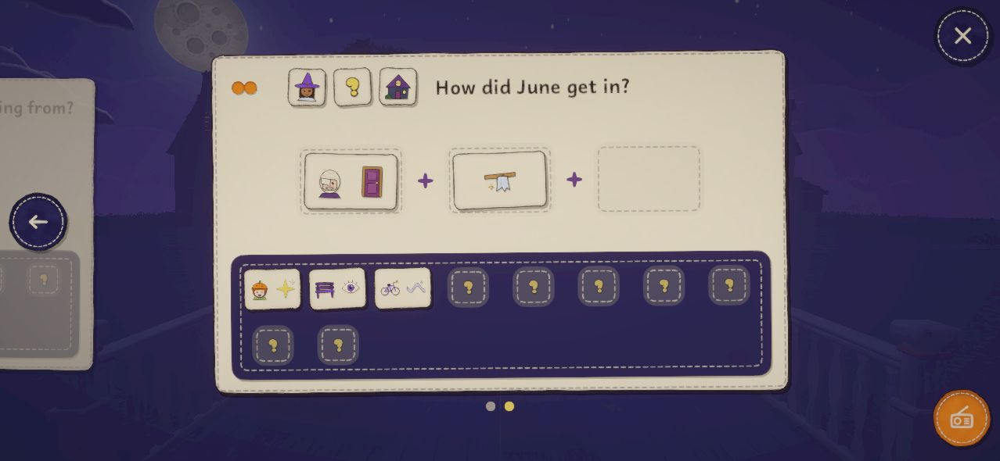
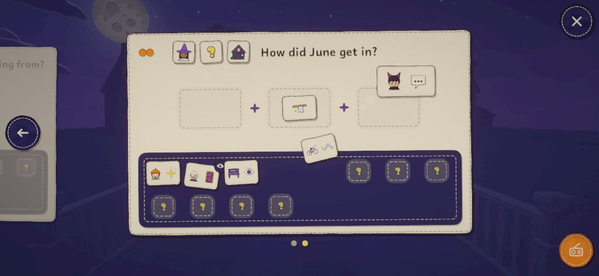
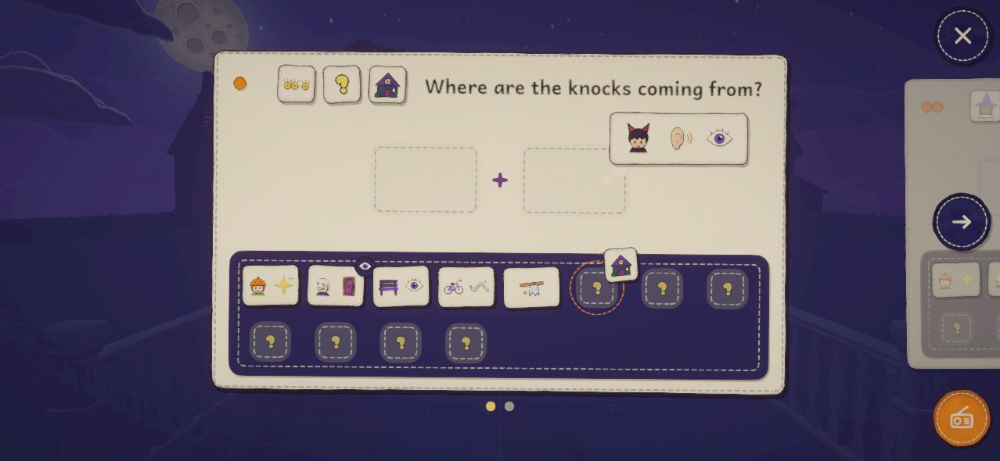
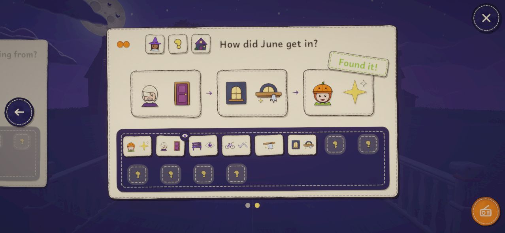
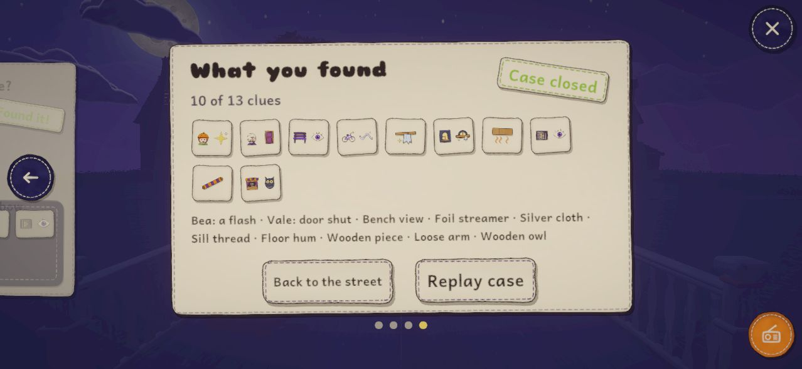
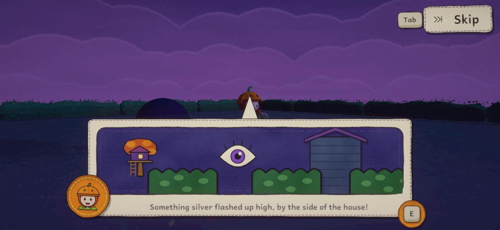
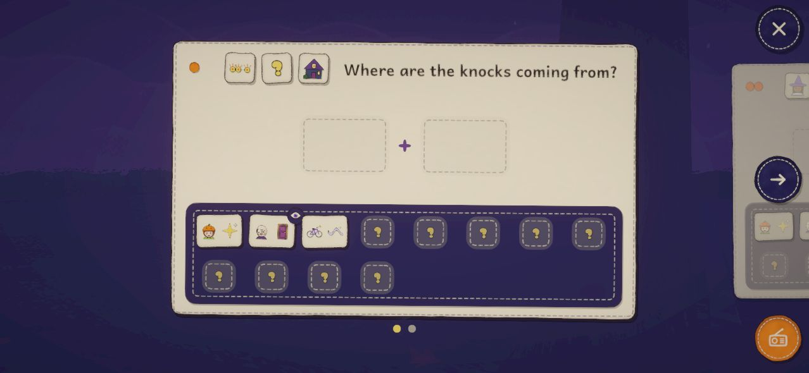

# S002.5a: mystery-first core and the deduction notebook

Branch `feature/s002.5a-deduction` (from `main` 8a7da88, merged with `main` up to 01bffa8). Not merged. Contract: spec v1.4,
`docs/mystery-first.md` (D26), `docs/roadmap.md` §5 increment 1, `docs/narrative-bible.md` §6 checklist.

Mock: `docs/evidence/s002/mystery_first/mf_notebook_deduction_sheet.jpg` and `mf_deduction_help_sheet.jpg`.

## 1. What shipped

### Case data model (Core, engine-free)

- **True story stays in the facts.** `CaseDefinition` keeps every shipped fact ID and adds nine additive ones:
  four sticker facts (`c01.porch.door_tried`, `c01.foyer.floor_hum`, `c01.workshop.owl_panel`,
  `c01.workshop.arm_loose`, `c01.porch.owl_seen`), the three deductions (`c01.solved.source|entry|moved`) and the
  stamp `c01.case.stamped`. `CaseClosed` keeps its ID and now means the reopening (Kit's owl show).
- **Clues as stickers** (`CaseNotebook.Stickers`): 12 tray stickers plus the saved-sweet keepsake, each with a stable
  ID (`c01.sticker.*`), the one fact that earns it, the place it is found (a `CaseAnchors` ID), a perception note and
  a short tag. Bea's flash, Vale's door, bench view, stuck door, foil streamer (the honest decoy), silver cloth, sill
  thread, floor hum, wooden piece, owl panel, wooden owl, loose arm. Where each is earned:
  - stuck door: Use the front door while latched (it can no longer be found once the door is open);
  - floor hum: entering the hall (the caption plays once, when the sticker arrives);
  - owl panel: Use on the owl-painted service panel (`ExamineOwlPanel`, it opens on the mechanism);
  - loose arm: the crank before linking, or linking the arm (implied);
  - wooden owl: the owl's bow in the cutaway (implied by `TestedOwl`).
- **Questions raised by the world** (`CaseQuestion.RaisedBy`): the knocks raise "Where are the knocks coming from?";
  Bea, Vale (or June, for a child who climbed in first) raise "How did June get in?"; the workshop (the wooden piece,
  the owl panel or the dangling arm) raises "What should the knocks move?".
- **Ideas and slots.** One slot per idea; a set is right when every idea is covered by a different sticker (a
  perfect matching, slot order never matters): source = floor hum + wooden piece; entry = (Vale's door | stuck door)
  + (cloth | sill) + (Bea's flash | bench view | the other snag); moved = (owl panel | wooden owl) + loose arm.
- **Solved state.** Only `CaseAction.Solve(question, stickers)` writes a solved fact, and the reducer re-checks the
  set against the stickers found. The stamp needs the reopening and all three deductions; the show stays tied to
  world actions (D26 Q1a). At the porch with questions open, Kit asks "So, detective, what happened here?"
  (`c01.line.kit.ask`) and the notebook opens on the first open question.

### Deduction logic (`CaseDeduction`, `DeductionBoard`, `DeductionCursor`)

- Slots per question, the shared tray (found stickers not on this page's slots), one generic "?" per clue still out
  there (count only).
- Scaffold (§5.4): wrong tries 1–2 send every sticker home; from try 3 the stickers that fit stay (pinned, never a
  check mark); after try 5, with every needed clue found, the decoy is set aside for that question (pencil circle,
  refused if placed). Tries are memory only (§5.5).
- The comic is the child's own stickers in idea order; a found bonus panel waits for the wind wheel (S002.5b).
- Stuck musing (`CaseDeduction.Musing`): two pictures per question (listen/look, door/up high, owl/arm) and, when a
  needed clue is unfound, the **place** of the first findable clue that would cover one more idea. Never a pairing;
  never a clue that can no longer be found.
- One cursor model serves tap-tap, keyboard and gamepad (D25).

### Save (schema 2, with migration)

- `CaseSaveData.CurrentSchemaVersion` = 2. New field `answers`: `"questionId=sticker+sticker"`, only right sets of
  solved questions (validated on every read; a solved question without one gets a canonical comic). The notebook
  field now lists found sticker IDs then solved question IDs, derived from the facts as before.
- **Migration 1 → 2** (`CaseSaveCodec.MigrateDeductions`, runs once, only on schema-1 files): in schema 1 the
  notebook had answered a question by proof, so that player keeps it. Attic entry (or June, or the open door) solves
  the entry question; the cam (or the arm, or the bow) solves the source question; the bow solves the moved question;
  a closed case keeps its stamp. Answers are derived from the stickers that save had found. A schema-2 save with the
  same proofs is never "helped".
- Atomic writes and recovery are unchanged (`SaveSlotStore`); a test crashes the first schema-2 write at every file
  operation and the save always reloads with the derived deduction.

### Notebook rebuild (`NotebookView`, `NotebookView.Deduction`, `NotebookSticker`)

- One page per raised question (carousel, dots, edge arrows kept); the order badge, picture chips and the question
  words; 2 or 3 identical dashed slots joined by a drawn "+"; the felt tray with stickers and "?" outlines.
- Drag a sticker onto a slot (it lifts and follows the finger; dragging never swipes the page), or tap the sticker
  then the slot; tap a placed sticker to send it home. Keyboard: arrows/WASD move, Enter/Space/E use, Esc/Backspace
  back or close, Q/R or Page Up/Down turn pages; gamepad: d-pad or stick, South, East, shoulders. A candy-yellow
  stitch marks the cursor; the held sticker lifts with an orange stitch.
- Full set → 0.4 s pause → wrong: the slots shake, the stickers wobble home in turn, Pip's thought cloud (no count,
  no red); right: the stitches glow orange, the case records it, the comic draws itself panel by panel twice and
  holds, then the *Found it!* stamp; the last deduction slides to the case-closed card.
- The radio on an open question gives the musing and lights a "?" with its place badge.
- The notebook disc on the HUD wobbles when a sticker arrives or a question is raised (§5.7).

### Spoilers removed (audit §8 items that belong to S002.5a)

- The notebook answering itself on attic entry, the cam and the bow: gone (questions answer only to stickers).
- Pre-shaped per-clue annotation slots: gone (one shared tray; slots are identical).
- Green check stamps inside vignettes: gone (`arm_linked` and the three `vg.notebook.*` strips, which are retired).
- Objective titles that narrated the route ("Find June's way in", "Fix what's loose", …): the ten
  `c01.objective.*` keys are retired; `CaseHints.OpenQuestionKey` gives the open question instead.
- Strings rewritten per §8 with translator context: Bea's three lines, June's greetings and listen line, the cloth,
  sill, streamer and door examines, the hum, arm and crank captions, the three questions and answers, every sticker
  note and tag; new: the owl panel examine, Kit's question, five notebook accessibility names.
- Vignettes rewritten as perceptions (existing parts only): Bea's flash (saw_cape, repeat, door_open: a silver glint
  over the hedge, gone; no June, window, pointing hand or ring), the cloth and sill (flutter and glint, no ring, no
  cape), the streamer (crinkle and twinkle, no cape, no ⊘), the stuck door (rattle, no padlock), the crank gap (the
  arm swings, no ring, no ⊘), June's listen line (ear and knocks, no jumping floor), the latch (no ring), the sweet
  (no ring). A Core test now forbids the ring cue, the check stamp and the key ring in every case line.
- Memory replays no longer auto-play (§7); Vale's are offered on demand from his sticker. Bea's two stay withheld
  until S002.5b restages them as a blur (they still re-enact June's route into the window).

## 2. Deferred to S002.5b (and why)

The roadmap lists these in S002.5a; they are left for S002.5b so this increment lands the foundation cleanly:

- **Hint retiering (visual).** The tier-1 object sparkle, the tier-2 goal sticker and the tier-3 ghost hand on Use
  are unchanged; only the tier-1 and tier-2 *lines* that narrated the deduction were rewritten as sensory area lines.
  The authored area table, breeze nudge, area trail and move-only demos are S002.5b work (they share the area table
  with the four new world targets). Tier-3 action lines are unchanged.
- **New puppet parts** (silver flash, blur streak, wind wheel, owl panel, booth owl, loose arm): the graphics stream
  (`fable`) was not run; the rewritten vignettes use existing parts (sparkle, hedge, owl, arm).
- **World targets with idle attractions** (wind wheel, booth examine, owl panel glint) and the wind-wheel bonus
  panel; Bea's replay restaging; the one-time ghost-hand drag demo (§5.7).

## 3. Tests

- Core (`tools/core-tests` and Unity EditMode): `CaseDeductionTests` (every placement enumerated: the accepted sets are
  exactly the design's; the decoy never completes; slot order never matters; questions raised by the world; nothing
  pre-solved from any reachable state; scaffold progression; decoy kept while a clue is missing; the stamp rule; no
  deduction deadlock from any reachable state; the musing points to places only; the tray count; answers round trip;
  schema-1 migration; crash at every step of the first schema-2 write), `DeductionCursorTests`, and the updated case,
  save, vignette and replay suites.
- PlayMode `DeductionNotebookTests`: the canonical playthrough (questions raised step by step, a wrong set by tap-tap
  wobbles home while Pip thinks, right sets solve all three, the porch stamps the case, the answers survive a
  reload); nothing pre-solved after every world action; touch drag (drag never swipes, a wrong pair goes home, a right
  pair draws the comic); the keyboard cursor picks, places, solves and Esc closes.

## 4. CI evidence

**CI run 111** (`45089229698`, head 3e9eea9): all green.

| Results | Total | Passed | Failed |
|---|---|---|---|
| EditMode (Unity) | 482 | 482 | 0 |
| PlayMode | 84 | 84 | 0 |
| Visual | 9 | 9 | 0 |
| Core (`tools/core-tests`, local and static job) | 447 | 447 | 0 |

New fixtures in that run: `CaseDeductionTests` 17/17, `DeductionCursorTests` 3/3, `DeductionNotebookTests` 4/4,
`DeductionCaptureTests` 1/1. Earlier runs on the branch: 104 failed at compile (Unity's NUnit has no `Is.AnyOf`);
105 failed three older tests (the hum caption wrapped to three lines, the attic-first test met the new owl-panel
line, Bea's line text), all fixed in 111.

## 5. Frames (reviewed)

Frames copied from run 111 into `docs/evidence/s002_5/`. Compared with the mocks
`mf_notebook_deduction_sheet.jpg` and `mf_deduction_help_sheet.jpg`.

| Frame | Shows | Review |
|---|---|---|
|  45 | "How did June get in?": two stickers placed, a third slot empty, the felt tray with three stickers and nine "?" outlines | Matches the mock's page: order dots, picture chips, the words, identical dashed slots, drawn "+". Nothing marks which clue belongs where. |
|  46 | the streamer made a wrong set: mid-wobble home, Pip's thought cloud | The mock's frames 3–4: stickers tilt on their way back, Pip thinks; no count, no red. |
|  47 | radio on "Where are the knocks coming from?": Pip + ear + eye, one "?" ringed orange with the house badge | The help mock: listen, then look; the place, never a pairing. |
|  48 | the right set: the comic is the child's own stickers (Vale's door → sill thread → Bea's flash), *Found it!* | The mock's frame 6 shows drawn scenes; ours enlarges the stickers, as §5.3 asks (built from the child's stickers). The stamp sits on the comic's top-right corner. |
|  49 | the case card: 10 of 13 clues, the stickers, their names, Back / Replay | Clean; the names wrap on two lines. |
|  24 | Bea's line: "Something silver flashed up high…" with treehouse, hedge, house, the eye | Only what she saw (the flash itself is a sparkle part; a dedicated flash part is S002.5b art). |
|  15 | the notebook early: one raised question, the tray, Vale's eye badge | The eye badge overlaps the next sticker slightly; acceptable, can be nudged in 5b. |

Self-assessment against the mock: about 4/5. Gaps: no sticker peel and *tok* sounds yet (S003 audio), the comic
panels are enlarged stickers rather than drawn scenes, and the stickers use existing puppet parts.

## 6. Known gaps

- Everything in §2 (hint retiering visuals, puppet parts, world targets, Bea's replay restaging, the drag demo).
- Wrong tries are memory only by design (§5.5), so the scaffold restarts after a relaunch.
- Raising "How did June get in?" also on meeting June (beyond the doc's "Bea or Vale") avoids a child who climbed in
  first never seeing the question; the owl-booth sticker comes from the bow until the booth examine target exists.
