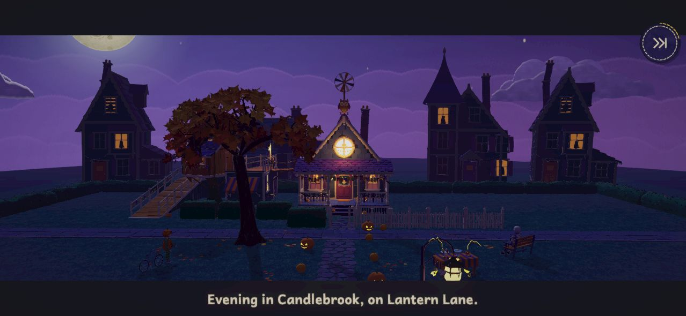
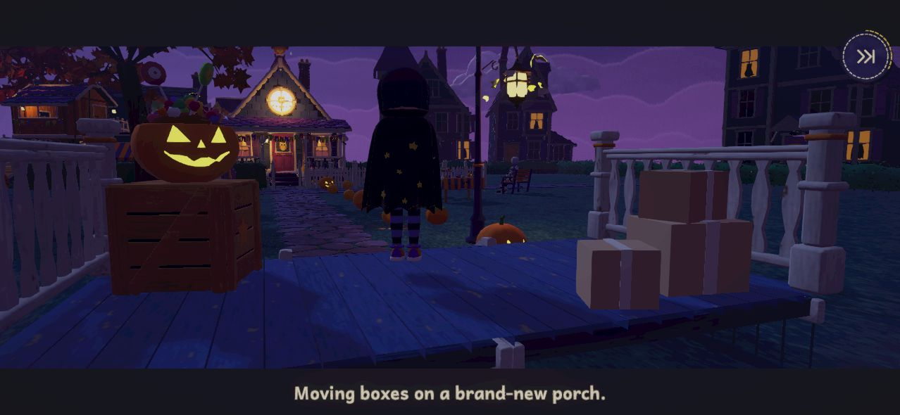
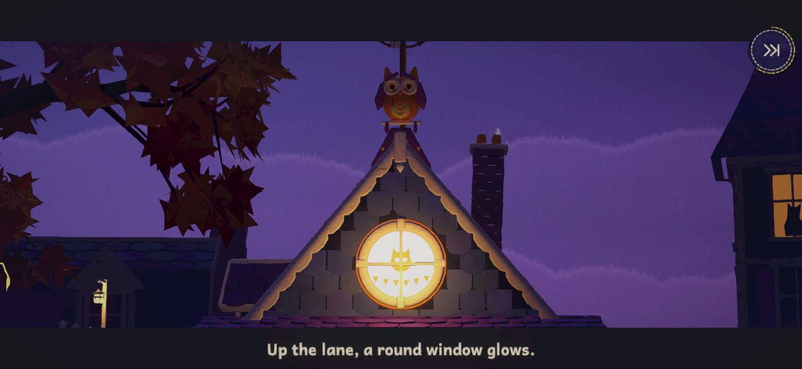
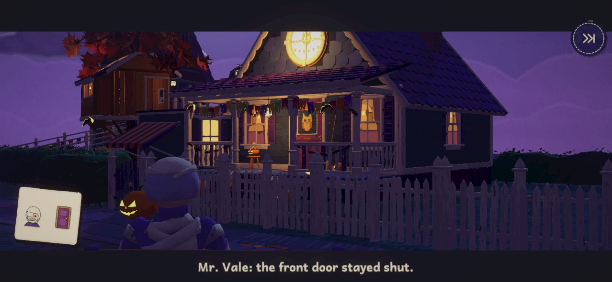
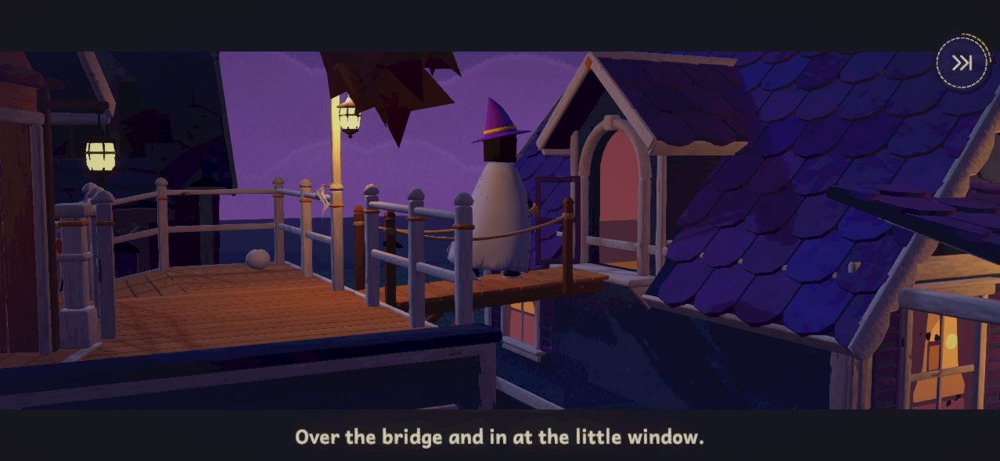
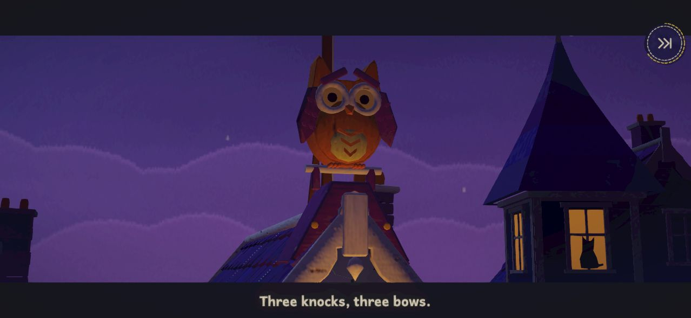
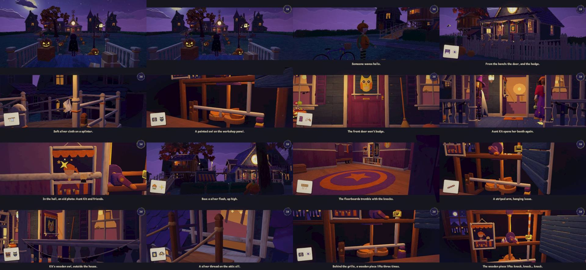

# S002.5b: the cutscene system, case 01's opening and reveal payoff

Branch `feature/s002.5b-cutscenes` (from `main` 3a1d535, merged with `main` up to ab033c6). Not merged. Contract: spec v1.4 §5–§7, D23.1, D24/D24.1,
D25, D26, D27/D27.1 (Candlebrook), D28; `docs/narrative-bible.md` §5 "Cutscenes" and the §6 checklist;
`docs/roadmap.md` §1.1 (System row) and S002.5b stream D; `docs/world-and-cases.md` case 01 slots.

## 1. What shipped

### Core, engine-free (`Core/Cutscenes`)

- **Data** (`Cutscene.cs`). A `Cutscene` is a list of `CutsceneBeat`s plus an exit blend and the *settle*
  placements that must hold however it ends. A beat holds one idea for a few seconds: a `CameraShot` (eye, aim,
  FOV, transition `Blend`/`Cut`/`PageTurn`, an optional eased drift, an optional run-time anchor such as the
  rooftop owl or Kit's photo), a caption key (the hybrid text line, D23.1), an optional comic vignette insert, the
  child's sticker (reveal), `CastCue`s (place, walk a path, loop, one-shot clip, gesture with aim, head look-at,
  hide, show), `SignalCue`s (babble and music IDs as placeholders for S003, world effects such as the mechanism
  cycle), and an optional wait point (hold at the end until a signal, with a limit).
- **Evaluator** (`CutscenePlayback`). Advanced with game time (pause gives 0 and freezes it). It sub-steps at every
  beat boundary, so every cue fires exactly once, in order, whatever the frame rate; small float leftovers are
  absorbed so 30 and 60 fps end each phase on the same frame. The camera pose is a pure function of beat and time:
  blends ease from the last pose of the previous shot, drifts ease over the beat. A blend between the street and
  the interior is always a cut (D24.1; the reveal turns the page there instead). Reduced motion cuts every blend,
  holds each drift's end framing, drops the letterbox slide and skips without a blend back. **Skip** works at any
  time: straight to the outro (0.35 s back, 0 under reduced motion), no cue fires after it.
- **Skip gate** (`CutsceneSkipGate`). The skip disc skips at once; any other tap, key or button first arms it ("Press
  again to skip") and a second press within 2.5 s skips; presses in the first 0.25 s are the press that started it.
- **Policy** (`CutscenePolicy`). New game → the opening unless this save saw it. Continue/reload → nothing. After a
  case step → the reveal only when that step gained `c01.case.stamped` (the three deductions and the reopening,
  D26) and the save has not seen it. Rewatch: the opening always (it holds nothing to solve), the reveal once stamped.
  `Build` returns null for a reveal before the stamp: **never ahead of the child**.
- **Seen set** (`CutsceneProgressStore`, file `case-c01-cutscenes.json`). The `NonverbalProgressStore` pattern:
  atomic write and previous copy through `SaveSlotStore`, tied to "this save" by its basis facts, cleared on a new
  game or a replayed case, outside the case save (schema unchanged). Marked before a first play, so a skip, crash or
  quit never replays it by itself.
- **Content** (`C01Cutscenes`).
  - **Opening** (20.5 s, plus up to 1.5 s waiting for Pip's walk, 0.8 s back to play): (1) Candlebrook at dusk over
    Lantern Lane, a slow crane down; (2) moving boxes on the arrival porch as Pip steps out to its front edge (the
    beat waits for Pip to arrive); (3) the owl house's round window glowing up the lane (a long lens, slow push);
    (4) Bea waves hello by her bicycle (her `Wave` clip, turned toward the porch); (5) the arrival-porch
    composition, drifting into the exact play camera behind Pip. It settles Pip on the spawn facing the owl house;
    the three knocks then happen in play (spec v1.4 §5).
  - **Reveal** (28.4 s: always 3 + 2 + 2 sticker shots, 0.8 s back): for each question in the true story's order (June's way in, the
    knocks, what they move) one 1.6 s shot per sticker the **child** placed, in the comic's idea order, with that
    sticker popping in and its perception note as the line, then a 3.2 s story beat: June walks across the treehouse
    bridge and slips in at the little window; the cam turns and the wooden piece knocks three times (the crank
    cutaway's framing, nook wall aside); the rooftop owl bows on the three knocks. Then Aunt Kit opens her booth with
    June waving (`OpenBooth`, `Wave`), and the season seed: a slow push on Kit's old troupe photo in the hall with
    one soft glint, captioned only "In the hall, an old photo: Aunt Kit and friends." Sticker shots exist for every
    sticker of every accepted set (11); the decoy never appears.
  - Only existing clips: Walk, Wave, Point, OpenBooth (plus head turns). No hand-keyed animation.

### Runtime

- `CinematicFrame` (UI): the memory replay's letterbox bars, optional tint and vignette, tap catcher, skip disc with
  its caption and candy progress ring, extracted from `MemoryReplayView` (which now uses it) and reused.
- `CinematicBlends`: the replay's Cinemachine custom blend, extracted and reused (in from play 0.6 s, out 0.8 s,
  cuts under reduced motion, from the title, or between the street and the interior).
- `CutscenePlayer`: one Cinemachine camera driven by the evaluator; the frame; the text line in the bottom bar; the
  child's sticker (the notebook's own `StickerCard`) popping in at the lower left; an optional `VignettePlayer`
  insert; the thresholds' paper page-turn (`ThresholdWipeView` + `ThresholdWipe`) raised so the cut happens under
  the covering page. Skip input: the disc, a tap, keyboard Space/Enter/E, gamepad South/East/West (D25). Escape and
  Start stay Pause; pausing freezes it and a press while paused belongs to the pause menu.
- `CaseCutscenes` (the stage and triggers): holds play through the director (HUD hidden, gameplay input off, control
  back the next frame, arrival triggers re-based so the opening's walk never fires the knocks); walks Pip through
  the motor with a scripted stick (`GameInput.ScriptedMove`, so the real walk clip and collisions play); places,
  walks, gestures, hides and shows witnesses; world effects (door shown shut for the door stickers, nook wall aside,
  mechanism cycle, photo glint); shows the interior for an indoor lens; restores everything from the facts after.
  Kit's photo and the owl are resolved from the real models. Moving boxes (kraft, taped) on the porch's back corner.
- `NotebookRewatch`: a watch disc with Pip's picture in the notebook's top-left corner replays the opening from any
  page; the case page (final card) gets a disc with the owl that replays the reveal; keyboard V and gamepad North
  rewatch too. The notebook reopens afterwards; a rewatch never moves Pip.

### Integration (small, separate edits)

- `CaseDirector`: creates `Cutscenes`; `StartNewCase` calls `Cutscenes.OnNewGame()` after the porch spawn (Continue
  does not); `ResetCase` calls `OnCaseReset()`; two internal hooks (`HoldForCutscene`, `HidePipForCutscene`); the
  sky decision follows the cutscene's lens; `UseTemporarySaveDirectory(playOpening = false)` keeps every existing
  fixture starting on the porch in control.
- The reveal waits for the screen to be free (no finale framing, no notebook, no page-turn, no cutaway, no replay).
  The stamp needs the reopening, so the reveal always comes after `FinaleView`, never on top of it: if the child
  solved everything first, the show plays on the porch, then the case card, then the reveal; if the show came first,
  the third deduction's comic, the case card, then the reveal. The owl show stays tied to the world action (D26).
- `GameInput.ScriptedMove` (3 lines), `NotebookView.StickerCard` made internal. `CameraRig` is untouched.

### Audio hook (placeholders until the voices/music wiring merges)

- Music cue IDs follow the audio branch: `music_street_theme` (opening) and `music_reveal` (reveal). Babble cues are
  `speaker.emotion` with the library's emotions (`neutral`, `happy`, `surprised`, `thinking`, `whisper`):
  `bea.happy` in the opening, `kit.happy` and `june.happy` at the reopening (`CutsceneAudio`).
- `ICutsceneAudio` (`PlayCue`, `Babble`, `Stop`, `Duck`) on `CaseCutscenes.Audio`, silent by default
  (`SilentCutsceneAudio`), so this branch does not depend on `feature/s003-voices-music-wiring`. A cutscene ducks the
  street when it starts, plays its music and babble cues, and stops its music and unducks when it ends or is skipped
  (a PlayMode test records the calls).

## 2. Tests

- **EditMode / Core** (`CutsceneTests`, 21): every cue once and in order at 30, 60 and a jittery 24 fps (opening,
  reveal, a sample with every transition, cue and a wait); the camera, letterbox and caption identical at 30 and
  60 fps frame by frame; blends start on the last frame and land on the shot; the reveal's street/interior
  crossings are page-turns; cuts reported on their frame; skip at every 0.37 s of the opening and before the first
  frame, nothing after; reduced motion holds every frame and skips at once; pause; the wait point (no signal, early,
  during the hold); the letterbox; the page-turn lead; data rules; anchor frames; the skip gate; the seen set round
  trip, its own file, Continue/reload never replay, reset and replay clear it; **never ahead**: for every reachable
  state the reveal exists only when stamped and only the stamping step triggers it; **built from stickers**: for
  every accepted entry × moved set (shuffled slot order) the sticker shots equal the comic order, the decoy never
  appears, 20–30 s; different choices give a different reveal; short beats and existing clips only; the opening ends
  on the play camera and the porch; captions are keys with context, state no conclusion, and the opening names no clue.
- **PlayMode** (`CutscenePlayTests`, 5): a new game plays the opening (HUD hidden, controls off, Pip walks onto the
  porch, captions play) and gives control on the porch, then walking plays the knocks; skip by the touch disc, by
  two taps, by keyboard Space ×2 mid-walk, by gamepad South ×2 under reduced motion; pause freezes it; the third
  deduction plays the reveal once from the child's stickers (sticker pops, the page turns, Pip hidden, everyone
  restored after), the reveal refuses to play before the stamp, and a reload + Continue plays nothing; the notebook
  rewatches the opening (Pip unmoved) and the reveal (touch, keyboard V, gamepad North), reopening the notebook.
- `CaseInteriorTests` now skips the reveal before asserting control after the finale.
- **Visual** (`CutsceneCaptureTests`): frames 50–55 plus small review frames of every other beat.

## 3. CI evidence

**CI run 121** (`45103595342`, head 2eb929b, `main` merged): all green.

| Results | Total | Passed | Failed |
|---|---|---|---|
| EditMode (Unity) | 578 | 578 | 0 |
| PlayMode | 108 | 108 | 0 |
| Visual | 12 | 12 | 0 |
| Core (`tools/core-tests`, local) | 550 | 550 | 0 |

New fixtures in that run: `CutsceneTests` 22/22, `CutscenePlayTests` 5/5, `CutsceneCaptureTests` 1/1; the updated
`CaseInteriorTests` and the refactored memory replay (`NonverbalUiTests`, `HintPicturesTests`) pass. Earlier runs on
the branch: 118 failed at compile (a readonly field assigned outside the constructor); 119 (all green) and 120 (all
green, after merging `main` 6e78392) gave the frames reviewed below, which led to the framing fixes.

## 4. Frames (reviewed at phone size)

Frames 50–51 are taken by `docs/evidence/s003`, so these use 52–57. Every other beat is in the review sheet.

| Frame | Shows | Review |
|---|---|---|
|  52 | dusk over Lantern Lane: the owl house at the end, Bea and her bike left, Vale's bench right, "Evening in Candlebrook, on Lantern Lane." | Reads at once: the whole street, the lit round window as the focal point, bars and line clean. 4/5. |
|  53 | Pip steps out on the porch between the candy-bowl crate and the moving boxes, the lane ahead | Run 119 had the boxes filling half the frame; the lens moved behind the left side and the boxes shrank and lightened. Balanced (crate left, Pip centre, boxes right). 4/5; the boxes are plain code-built cubes. |
|  54 | long lens on the glowing round window under the rooftop owl | Run 119 aimed above the window (the greybox height); now the window, the owl and the gable fill the frame, the maple frames the left. 4/5. |
|  55 | over Mr. Vale's shoulder to the front door, the child's sticker (Vale + door) popping in, his note as the line | Run 119 had Vale's head over the door; the lens moved right so the door sits clear behind the fence. 4/5. |
|  56 | June (silver cape, witch hat) crossing the treehouse bridge toward the little window | Tighter lens, captured mid-bridge. 4/5. |
|  57 | the rooftop owl mid-bow on the knocks, "Three knocks, three bows." | Strong silhouette against the sky. 4/5. |
|  | review sheet: the opening's wave, porch and control frames, and every reveal shot (all 11 sticker places, the story beats, the reopening, the seed) | The porch beat lands exactly on the play camera (the control frame matches). Kit's photo was framed from the wrong side in run 119 (the anchor picked the hall's diagonal); it now faces the hall, but the mechanism's push rod still crosses the photo (see gaps). |

Self-assessment: about 4/5 for the six committed frames; the reveal's interior sticker shots (owl panel, loose arm,
wooden piece) read as "the machine" more than as each clue.

## 5. Narrative bible checklist (§6)

| # | Check | Result |
|---|---|---|
| 1 | Written true story explains every clue | Unchanged (spec §2); the reveal stages exactly that story. |
| 2 | Questions raised by the world | Unchanged; the opening raises none and shows no knock (the knocks stay in play). |
| 3 | Answers only from placed stickers | The reveal is built only from the child's saved right sets; `Build` is null before the stamp (tested over every reachable state). |
| 4 | Diegetic attractions, no precision moves | Unchanged; cutscenes add no route. |
| 5 | Testimony as perception | Sticker shots use the stickers' perception notes; Bea points up high, Vale looks at the door. |
| 6 | No vignette, caption or line states a conclusion | Captions describe what is seen ("Over the bridge and in at the little window."); a lint test forbids conclusion words. |
| 7 | Hints to areas only | Unchanged. |
| 8 | One decoy | The streamer never appears in the reveal (tested). |
| 9 | Reveal pays off found clues and the child's action | One shot per sticker the child placed; the owl bows because the child linked the arm and cranked. |
| 10 | No deadlock in any order | Cutscenes change no fact; the reveal waits for a free screen; tests cover both orders (show first, deductions first). |
| 11 | The street remembers | The reopened booth closes the reveal; the "street remembers" cutscene is S004 (roadmap). |
| 12 | Seed for a later case | Kit's troupe photo, unexplained, with one glint (the glowing puppet itself is S004 art). |
| 13 | New mechanics serve mystery or exploration | No mechanic added. |
| 14 | Strings in `en.json` with context, stable IDs | 13 keys (`ui.cutscene.*`, `c01.cutscene.*`) through `LocalizationKeys.Cutscenes`; the seen set stores IDs only; Candlebrook marked untranslated. |
| 15 | Guardrails (no timers, FOMO, purchases) | No timers; the skip ring shows progress without numbers. |
| 16 | Cutscenes short, skippable, rewatchable, in-engine, six purposes, never ahead | Opening ≈ 20.5 s (slot 1), reveal ≈ 28.4 s (slot 3); skip on every scheme; rewatch from the notebook; real models; nothing the child could find by playing (the opening shows the street from the porch, Bea and the lit window, all visible at play start). |

## 6. Gaps

- Babble and music cues are IDs only (S003 audio); the S003a gesture pass will retime the data.
- The "street remembers" and the seed cutscene with a glowing puppet are S004 (troupe photo art).
- The reveal leaves the hall's photo with a cut (and the letterbox fading) rather than a page-turn back to the street.
- In the seed shot the workshop's horizontal push rod crosses Kit's photo; a lens past the rod (or the S004 photo art
  hung higher) would read better. The owl-panel and loose-arm shots look alike (same nook).
- The music and babble hook is silent until `feature/s003-voices-music-wiring` sets `CaseCutscenes.Audio`.
- The moving boxes are code-built kraft cubes with tape, like the greybox; a Blender prop can replace them.
- No device run yet; frames are from CI's renderer.
