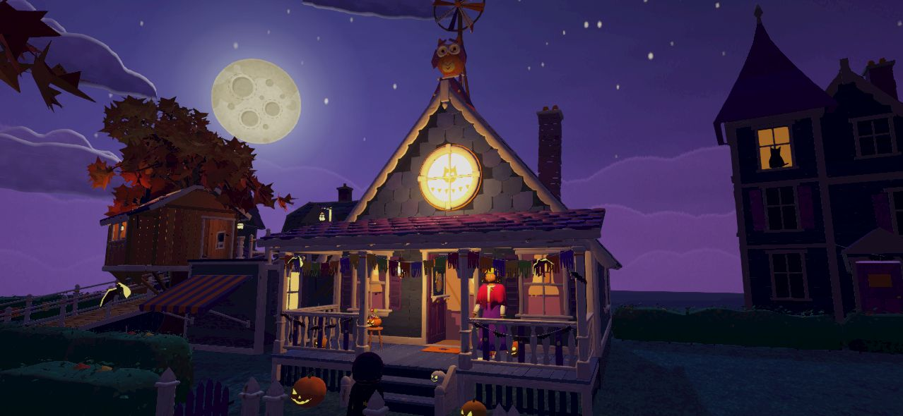
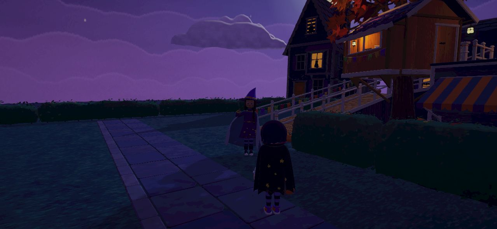
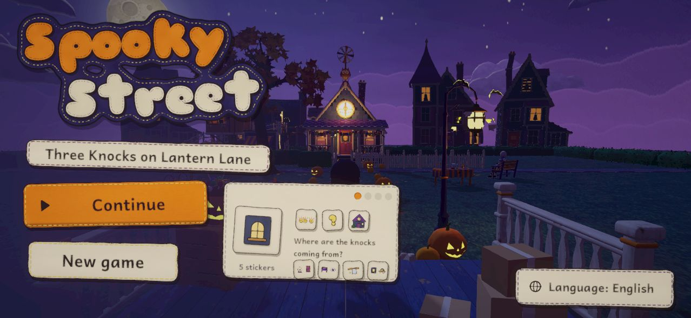
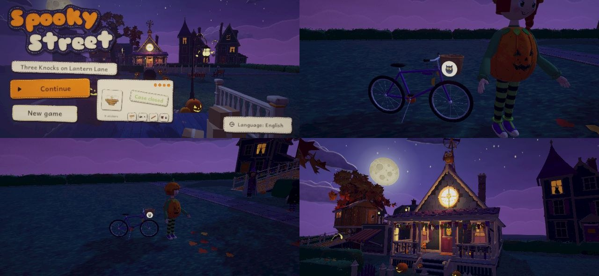

# S002.5b: the street remembers, and Continue's picture recap

Branch `feature/s002.5b-street-memory` (from `main` 35acc67, merged with `main` 61e5936, the voices and music wiring). Not merged. Contract: spec v1.4 §5 (Continue) and §7
(the `street` state, "replaying resets only case data"), D23.1, D25, D26, D27/D27.1, D28, new **D29**;
`docs/narrative-bible.md` §2 pillar 5 and checklist item 11; `docs/world-and-cases.md` §5 continuity rules;
`docs/engagement.md` §1.10 (Continue recap, chapter stops) and §2; `docs/roadmap.md` S002.5b stream B.

## 1. What shipped

### Core, engine-free

- **`Core/Street/StreetMemory.cs`.** `StreetMemory` (five case 01 memories) with stable IDs `street.c01.*`
  (world-and-cases §5 naming) and the case that leaves each; `StreetState` (solved cases and memories in the order
  gained, immutable, `Remember` is idempotent and ignores unknown cases); `StreetRules` (the street learns a case
  only from its "Case closed" stamp, `c01.case.stamped`; replay keeps it; a confirmed New game clears it);
  `StreetView` (what shows with the current case save: a case's memories rest while that case is being replayed,
  i.e. its save is not stamped; other cases' memories always show) and `StreetView.Apply`, which lays the memories
  over `CaseWorldView` through the new `CaseWorldView.WithStreet` (flags only ever open, so applying twice changes
  nothing). `JunePlacement.Treehouse` is new.
- **`Core/Street/StreetStore.cs`.** `StreetCodec` (`street.json`, schema 1: `solvedCases`, `memories`; unknown IDs
  dropped, newer schema detected) and `StreetStore` over `SaveSlotStore`: temp write then atomic replace with one
  previous copy, recovery from an interrupted temp or the previous copy, a newer build's file preserved (no write
  over it until an explicit New game sets it aside as `street.kept.json`). `Observe` writes only when something was
  gained, and doubles as the **migration from no file**: a save stamped before the street existed teaches it on the
  first load. Because every solved case can rebuild its memories from its own stamped save, a lost or broken street
  file heals on the next load.
- **`Core/Save/ContinueRecap.cs`.** The recap builder: the validated resume anchor (unknown → plaza, as Continue),
  the first raised unsolved question's ID, words and picture chips (`QuestionChips`, now shared with the notebook
  page), the found tray stickers in the order found, the total, the stamp flag and the soft chapter (1 + solved
  questions, 4 stops). It has no answer field of any kind: no answer words, comic, right set, hint or route.
- **`CaseStage`.** June's treehouse spot (−10.45, 0, 5.6, facing the plaza: beside the ramp foot, 1.1 m clear of
  the side-yard corridor) and its Talk point `june_treehouse`, offered only while June stands there.
- **Strings** (`en.json`, `LocalizationKeys.Recap`): `ui.title.recap_heading` "Last time", `ui.title.recap_stickers`
  "{0} stickers". The New game question now says the street's changes are cleared too; the replay question's
  translator context says the street is kept.

### Runtime

- **`StreetMemoryStage`** (`Runtime/Case`). Loads the street beside the case save, records the stamp, and shows the
  memories with existing art only:
  - **Kit's booth open and lit**: Kit at her booth (the closed case's own staging, now kept by the street) and a warm,
    unshadowed booth lamp over the ticket door;
  - **the rooftop owl bows now and then**: the owl stays linked and the wind cycle stays on (every 9 s);
  - **Bea's owl sticker**: the puppet-atlas owl on a small paper disc on the plaza side of her basket. Her closed
    line already says "Three knocks, three bows! I'm putting an owl on my bike.", so no new line was needed;
  - **the front door opens from outside**: it stays open both ways;
  - **June outside** at the foot of her treehouse way instead of the attic (she still talks there).
  The world view (June, door, booth, owl) is laid over the case's on load, after the case is closed; the lamp and the
  sticker follow the stamp at once, while June stays on the porch for the reopening until the next load.
- **`CaseDirector`** (small edits): creates the stage and the recap, loads the street after the case save,
  `ComposeView()` replaces the two `CaseWorldView.From(State)` calls, the stamp step calls `Street.Observe`, the
  confirmed New game calls `Street.OnNewGame`, and `RefreshTitle()` replaces the `SetHasSave` calls.
- **`ContinueRecapView`** (`Runtime/UI`). A paper card beside Continue, built from the notebook's own parts: the
  place's puppet picture on a tilted paper tag (`NotebookView.PlacePart`), the question's picture chips with its
  words under them (the hybrid text line), up to four tiny stickers (`NotebookView.StickerCard`) and "N stickers",
  and four candy dots for the soft chapter. A closed save shows the green "Case closed" stamp instead of a question.
  `GameUi` exposes `TitleContent` and `ContinueSlot` for it.

## 2. Decision D29 (replay)

Recorded in `docs/decisions.md`. Replay keeps the street; while the replayed case is open again its own memories
rest so the mystery is whole (a bowing owl before the arm is linked, or a door that opens from outside before the
latch is lifted, would break the clues); they come back with its stamp. A confirmed New game clears the street, since
Pip arrives as the new kid again in the opening. "Start fresh" after a save notice keeps it.

## 3. Tests

- **EditMode** (`StreetMemoryTests.cs`, also in `tools/core-tests`): `StreetRulesTests` (learns only from the stamp,
  a closed but unstamped case teaches nothing, idempotent remember/observe/apply, the world after the stamp, June's
  Talk point and its clearance from the ramp corridor, a later case's fresh world, replay keeps and rests, New game
  forgets, stable IDs); `StreetStoreTests` (codec, migration from no file, an interruption at every step leaves the
  old or the new street and the stamped save heals it, recovery of the previous copy and from an unreadable file, a
  newer file kept until New game, replay never touches the file); `ContinueRecapTests` (no answer in any state of two
  plays, chapters 1→4 as soft stops, the validated place, the count).
- **PlayMode** (`StreetMemoryPlayTests.cs`): closing case 01 and reloading shows the changes (and June and Bea still
  talk); replay keeps the street, rests its memories across a reload and restores them with the new stamp, with the
  migration from no file; a confirmed New game forgets; Continue's recap for a mid-case save and for a closed save.
- **Visual** (`StreetMemoryCaptureTests.cs`): frames 62–64 and review frames.

## 4. CI evidence

- `tools/check-local.sh`: all local checks pass (600 Core tests in `tools/core-tests`).
- **CI run 137** (`45113748636`, head 4262e04, before the `main` merge): all green, first try; `StreetRulesTests`,
  `StreetStoreTests`, `ContinueRecapTests`, `StreetMemoryPlayTests` 5/5, `StreetMemoryCaptureTests` 1/1. Its frames led
  to the fixes below.
- **CI run 140** (`45118171407`, head 2f2482b, `main` 61e5936 merged): all green. EditMode 633/633, PlayMode 119/119,
  Visual 13/13. New fixtures: `StreetRulesTests` 9/9, `StreetStoreTests` 6/6, `ContinueRecapTests` 4/4,
  `StreetMemoryPlayTests` 5/5, `StreetMemoryCaptureTests` 1/1. `VoicesMusicTests` 5/5 still pass with the merge.

## 5. Frames (CI renderer, reviewed at phone size)

Frames 58–61 are taken by `feature/s002.5b-clues-hints`, so these use 62–64.

| Frame | Shows | Review |
|---|---|---|
|  62 | after case 01, from the front path: Kit at her open booth in the warm booth lamp, the front door open and lit inside, the owl on the roof under the wind wheel, the treehouse to the left | In run 137 the roof cut off the owl; the lens moved back and up. The booth reads as open and alive next to the replay frame (sheet, bottom right: door shut, no Kit, darker porch). 4/5; the lamp is subtle, and the booth has no lit sign of its own (art wanted). |
|  63 | June (witch hat, silver cape) waving at the foot of her treehouse way, Pip walking up the side-yard path, the ramp and treehouse behind her | Reads at once as "June is outside now"; she stands clear of the ramp and the path. 4/5; dark lawn, she plays the Standing idle (no outdoor play loop yet). |
|  64 | the title with a mid-case save: Continue, and beside it the recap card: "Last time", the attic window (where Pip was), the knocks question as its three chips with its words, four tiny stickers and "5 stickers", one of four chapter dots | Run 137's stickers were too small to read; now 56 × 52. No answer, no route. 4/5; the card's words are small at phone size for readers, which is fine because the pictures lead. |
|  | review sheet: the closed-save recap (green "Case closed" stamp, porch, four dots); Bea's owl sticker on her basket, close and from the plaza; the booth during a replay (memories resting) | Run 137 put the sticker behind the saddle (the imported bike's +Z is the saddle end); it now sits on the basket's plaza side and reads from the plaza as a small white owl disc. 4/5. |

Self-assessment: 4/5 for all three numbered frames.

## 6. Gaps and art wanted later

- **Art wanted later** (no new models were made): a small lit sign or lantern string on Kit's booth (today the
  "lit" is a point light plus Kit's own staging); an owl sticker decal baked into the bicycle texture instead of a
  sprite disc; an outdoor play loop for June (skipping, tapping the knock rhythm on the ramp rail) instead of
  Standing; an owl house door "creak open" when Pip approaches from outside (the door simply stays open now).
- **Bea's line**: no new line; her closed line already promises the owl ("I'm putting an owl on my bike."). A
  greeting that changes after the stamp (narrative bible checklist 11, "a new greeting") is left for S003a with
  character actions, so it gets its vignette and babble together.
- **The street-remembers cutscene** (D28 slot 4, roadmap S004) is not built; the changes simply appear on load.
- **Chapter stops** are only shown as the recap's chapter dots; the warm goodbye card at a chapter stop
  (engagement §1.10, owner answer 4a) is not built.
- **The recap's last solved comic** (engagement §1.10) is left out on purpose: the caller asked for "never the answer".
  The owner may want it back for solved questions only.
- **New game clears the street** (D29 item 4) needs the owner's confirmation.
- No device run yet; frames are from CI's renderer.
