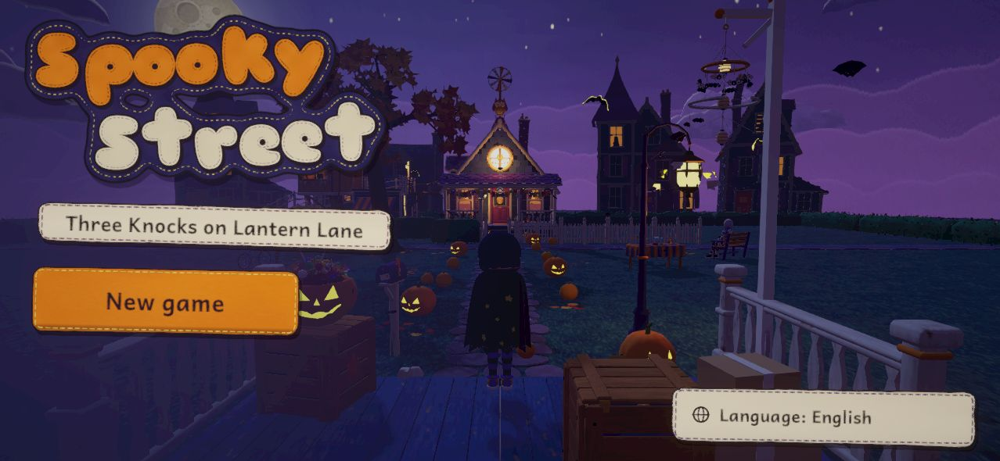
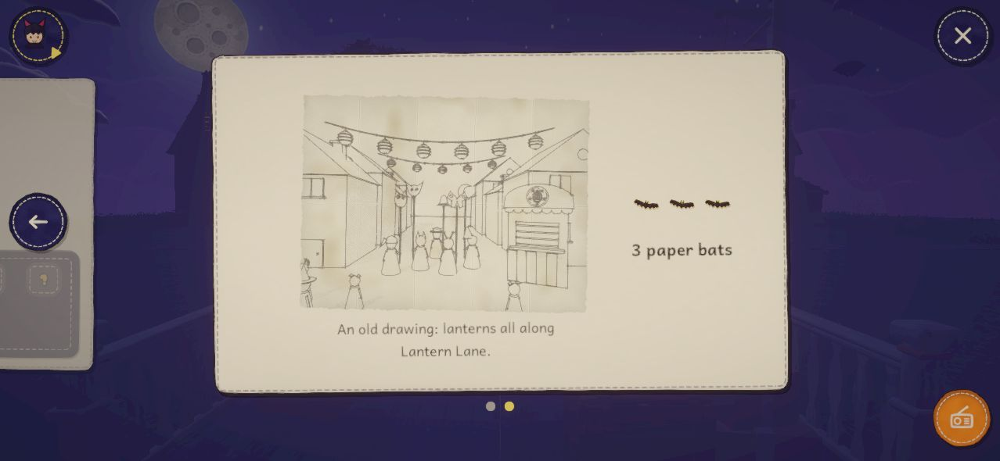
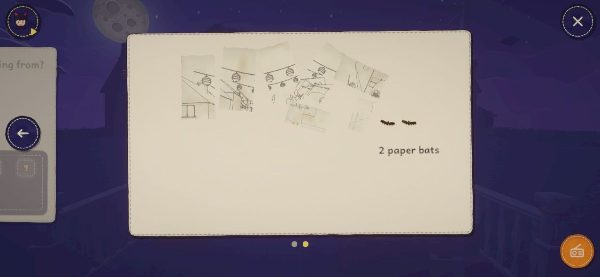
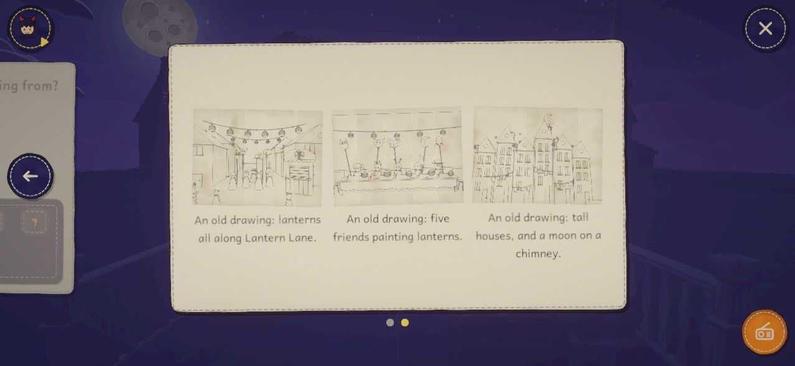
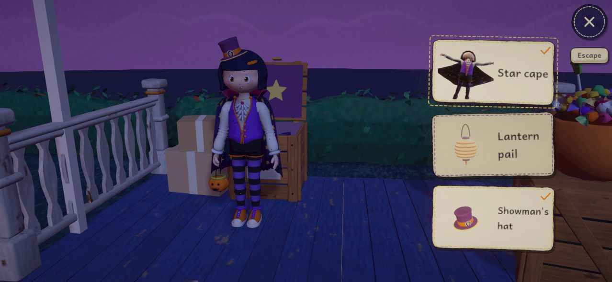
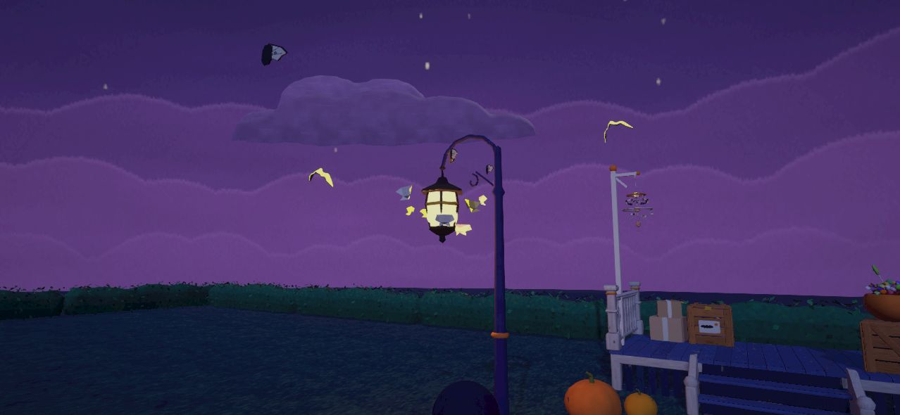
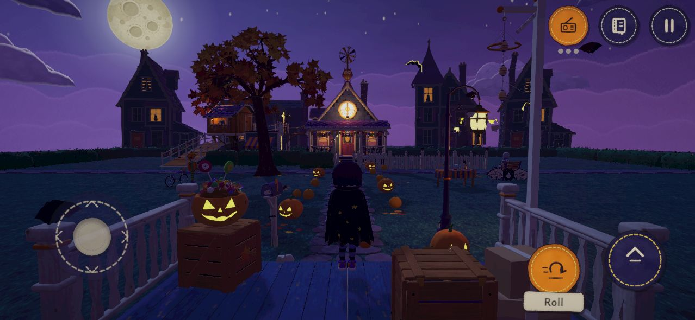
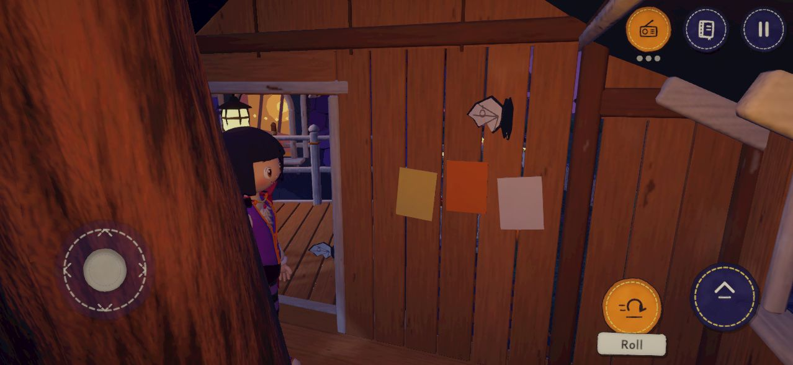
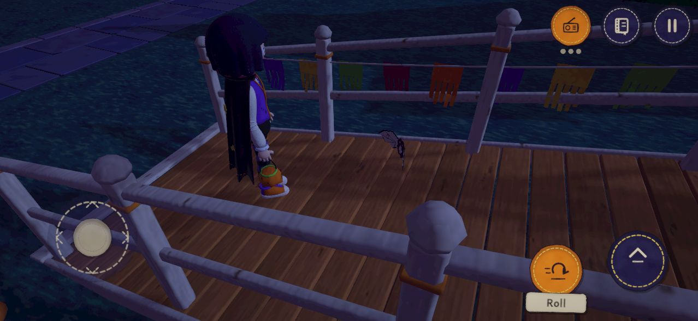

# S004 stream A2: keepsakes in play (the real bat, the mobile, the trunk, the sketch pages)

Branch `feature/s004-keepsakes-play` (from `main` b7c2e5e, with `fix/ci-visual-timeout`). Plan: `docs/S004-plan.md`
§2.1 and §3 "Stream A" (A2 scope). Builds on A1 (`docs/S004-keepsakes.md`) and the B art (`docs/S004-art.md`).

## What A2 adds

- **The real collectible bat** (`PaperBatCollectibles`, A1's swap point now `KeepsakeArt.PaperBat` =
  `PaperBatKeepsake.fbx`, at 1.6×, 0.54 m open, on the `Keepsakes` atlas). Shut it is ink black with a cream belly (wings at +/-150° about their local Z);
  folded, it faces the way a child comes to it (its move's start); within 2.4 m of Pip it turns its face to the play
  camera that follows her (edge-on to the lens it vanished in run 180), lifts 4 cm and spreads its wings to show the cream, pencilled inner
  fold, beating a little (still with reduced motion). It never glows: the decorative bats keep their glowing edge.
  Perched bats stand on their surface (origin at the body's lowest point = `SitY`), hanging and airborne bats are
  centred on their spot. The greybox stays as the fallback without the model.
- **A1 issue 2 (decorative bats next to collectibles).** Three decorative bats moved: the two round the street lamp
  (they sat 0.55–0.65 m from keepsake bat 21 on the lamp head), and the two under the owl house's porch eave (1.1 m
  from bats 15 and 25). `PaperBatLayoutTests.TheDecorativeBatsStayDecoration` now asks for the bats' own spacing,
  1.5 m, instead of 0.5 m.
- **The bat mobile** (`Runtime/World/BatMobile.cs`, rules `Core/Keepsakes/KeepsakePlay.cs` `BatMobileRules`). The
  arrival porch has no eave, so the mobile hangs from a cream porch post with an orange finial and a plant-hanger
  bracket on the east rail (run 180's dark pole with a bare arm read as a gibbet; changed in run 183) (`KeepsakePorch`:
  hook at 1.6, 3.4, −13.6; bottom 1.8 m over the deck; made in code like the moving boxes). Hook *n* and its bat show
  with bat *n* (no empty hook, no number); ring 1 is the frame, rings 2 and 3 appear with their first bat; at 10/20/30
  the ring's closing piece and its lantern (`KeepsakeLanternN_Glow`) show. Bats hang by their ears at
  `MobileBatScale`, wings 25° short of open, facing out; the mobile turns slowly in play (still on the title and with
  reduced motion).
- **The dress-up trunk** (`Runtime/Case/CostumeTrunk.cs`, `Runtime/UI/DressUpView.cs`). `DressUpTrunk.fbx` replaces
  the opening's small moving box on the porch's back corner (0.7, 0.6, −14.62), front to the street, with its own
  0.6 m `BoxCollider` (**A1 issue 4**: checked in play by a raycast onto its top, `KeepsakeDressUpTests`). It is a Use
  target ("Dress up", `ui.verb.dress_up`) through a new `ExtraUseTarget` on `CaseUseTargets` (never over a case
  point; the owl booth's knock is 26 m away), offered within 1 m of its front and **only once a piece is earned**
  (it never opens empty). Use: the lid swings open (+105°), Pip stands in front of it turned to the street, a fixed
  camera frames her with the trunk behind, and the screen shows one paper card per **earned** piece (picture + name),
  a worn piece marked with a candy stitch and a tick. A tap puts it on or takes it off at once and saves. Close disc,
  or Back on a pad or keyboard. Navigation is the F1 base (`UiFocusScreen`, graph `DressUpFocus`, tested sound in
  every state). Until all three pieces are earned a plum cloth covers the trunk's contents (the model holds all three
  things), so no unearned piece is ever seen.
- **Pip's costume** (`Runtime/Player/PipCostume.cs`): the star cape swaps the base map on a copy of the atlas material;
  the hat (`Head`) and the lantern pail (`Pail`, hiding `Pip_Pail`) are attached from the skinned meshes' bind poses
  with `KeepsakeArt.ShowmanHat`'s formula. Applied on load, so the title shows it; a confirmed New game takes it off
  with the keepsakes (decision 4).
- **Card pictures**: `UI/CostumeIcons/costume_icon_{star_cape,lantern_pail,showman_hat}.png`, 256², rendered from the
  exported FBX by `tools/blender/chars/costume_pieces.py icons` (Pip re-imported in her rest pose, the pieces on their
  bones; the cape seen from below in the glide so the star lining shows). Import rules in `KeepsakeArtImportRules`
  (v2), tested in `KeepsakeArtImportTests.CostumeIconsImportAsTransparentSprites`. Sheet:
  `docs/evidence/s004/keepsakes_play/costume_icons.png` (looked at: hat and lantern read at once; the cape card shows
  the violet star lining under her arms, the stars are small).
- **The 10th-bat moment and the sketch page** (`Runtime/UI/NotebookView.Keepsakes.cs`, `KeepsakeNotebook`). The find
  that completes a page wobbles the notebook disc once (the sticker-arrival cue, no pop-up, play goes on) and the
  page waits. The notebook gets its own **keepsakes page** after the case pages (the plan's "keepsakes page after the
  case page") from the first bat: only earned drawings, each with its `keepsake.page.*` caption, and a small pile of
  the folded bats not yet in a page with its own number (`keepsake.notebook.bat_stack`, plural, 1–9; never a total).
  The next time the notebook opens it turns to that page and the drawing assembles from ten pieces cut on its 5 × 2
  crease grid, flying from the pile (fading in place with reduced motion), once.
- **Costume remarks**: three case lines with context, vignettes (`C01Vignettes.Remarks.cs`), voices and portraits:
  June on the cape ("Stars on your cape! You look like the night sky!" — the plan's "Like my comet!" was changed so
  June never points at her own cape, a clue), Mr. Vale on the pail, Aunt Kit on the hat after the stamp. Conversation
  never picks them; after a talk the director appends the one `CostumeRemarks.Due`, records it in `keepsakes.json`,
  and it is never said again.
- **Continue line** (`ui.title.continue_detail`, "{question} · N paper bats"): shown only with a case to continue and
  at least one bat (no "0 paper bats"); a count, never a total (plan §3 A2 "count only"; engagement §2.3).

## Frames

A1 noted that 65–68 collide with S003a; 69–81 are reserved by other S004 streams, so A2 uses **82–85**
(`Tests/Visual/KeepsakePlayCaptureTests.cs`); A1's 65* frames now show the real bat. All from **run 187**, extracted
from the job log with `tools/ci/extract_frames.py` and looked at, in `docs/evidence/s004/keepsakes_play/`.

| Frame | What it shows | Verdict |
|---|---|---|
|  84 | The title, 12 bats found: the mobile (ring 1 closed with its lantern, two bats on ring 2) on its cream porch post top right; Pip in the star cape | Upper right, clear of the logo, the buttons and the language pill (viewport x 0.81–0.91, y 0.66–0.91). The post reads as porch trim (run 180's dark pole read as a gibbet). The bats on it are small at this distance |
|  82 | Notebook keepsakes page, 13 bats: page 1 with its caption; three folded bats on "3 paper bats" | Only the earned drawing, no empty frame, no total. The pile is small but sits on its number |
|  82b | The next opening after the 10th bat: the ten crease pieces flying in from the pile (held mid-flight for the capture) | Reads as the page piecing together; the caption appears when it lands |
|  82c | All 30: the three drawings and captions | Fits; the moon page's caption takes three lines |
|  83 | The trunk open behind Pip, facing the dressing camera in the star cape and the showman's hat; three cards, cape and hat ticked; focus outline on the cape card (gamepad), Escape prompt by the close disc | The hat sits on her head (feet y 0.62, hat 1.84–2.00), the violet star lining shows at her sides, the pumpkin pail stays (lantern off). Run 180 cut the hat off at the top; the camera was raised |
|  85 | Close: bat 18 open on the south hedge by Pip | Ink body with two dots, cream wings with pencilled fold lines; nothing like the glowing decorative bats. Run 183 showed it patchwork (the Env atlas); fixed |
|  85b | The lamp from the path: bat 21 folded on the lamp head; the decorative bats moved away (left, right) | The lamp head is now the collectible's alone. Folded at 6 m it is a small dark shape; the airborne bat 27 (top left) reads black and cream |
|  65d | Play start on the porch | Bat 01 opens on the east rail post, cream wings toward the camera, clear of the mobile's post; bat 02 at the left edge behind the stick (A1's note stands) |
|  65 /  65c | The cabin bat open on the wall; the ramp bat | 65 reads. 65c's review camera stands east of the play camera the bat turns to, so it is still seen edge-on there |

## Tests

- Core (`tools/core-tests`, also EditMode): `KeepsakePlayTests` (6): the mobile shows one hook per bat and lights at
  10/20/30 only; trunk and mobile placement on the porch (on the deck, clear of the crate, the opening walk, every bat
  and every case Use target, not offered at the spawn, the mobile over Pip's head and away from bat 01); the trunk
  only with an earned piece and its focus graph sound for every count; a page assembles once; the Continue rule;
  each remark a real case line with voice, portrait and valid vignette, never picked by a conversation. Updated:
  `VignetteTests` (45 lines, 43 vignettes), `PaperBatLayoutTests` (decor spacing), `NonverbalUiTests` (the remark
  lines). Local: `./tools/check-local.sh` passed (core tests all green, l10n 237 keys).
- EditMode project: `KeepsakeArtImportTests.CostumeIconsImportAsTransparentSprites`.
- PlayMode `KeepsakeDressUpTests` (7): the 10th bat (disc wobble, no pop-up, page 1 assembles once on the next
  opening, the 11th in the stack); the mobile hangs exactly the found bats; the trunk's collider, Use, cards, Pip
  dressed (hat on the head bone, lantern in hand, pumpkin pail hidden), saved, Back closes, reload shows the costume
  on the title; the trunk stays shut with no piece and hides unearned ones; New game takes the costume off; June's
  remark once; the Continue line; the world's and the mobile's bats draw from the `Keepsakes` atlas.

## CI

Workflow `CI` on `feature/s004-keepsakes-play` (Unity 6000.3.28f1):

| Run | Commit | Result | What it showed |
|---|---|---|---|
| 180 | `0732944` | failed (Visual 20/21) | EditMode 834/834, PlayMode 156/156 (`KeepsakeDressUpTests` 7/7) green on the first push. Frame 85 asked bat 01 to open with all 30 found. Frames: the mobile's dark pole read as a gibbet, 83 cut the hat off, the bat stack's number fell off the page, 82b caught the pieces already landed, the keepsake bats were specks edge-on to the lens |
| 183 | `5f42bac` | **passed** (843 / 158 / 22) | Fixes for all of the above. The frames showed the keepsake bats drawn through the Env atlas (patchwork) |
| **187** | `a1f5151` | **passed** | EditMode **843/843** (`KeepsakePlayTests` 6/6, `KeepsakeArtImportTests` 22/22 with the icons), PlayMode **158/158** (`KeepsakeDressUpTests` 7/7 with a new atlas check, `KeepsakePlayTests` 4/4, `NonverbalUiTests` with the remark lines), Visual **22/22** (`KeepsakePlayCaptureTests` 1/1, `KeepsakeCaptureTests` 1/1); static checks green. The frames above |

Between 183 and 187 `origin/main` was merged three times (CI timeout fix, cutscenes, pt-BR table, Pip-is-a-girl
contexts); run 187 includes all of them. pt-BR lines were added for every new key (style of
`docs/S004-ptBR-review.md`, regenerated): "Estrelas na sua capa! Você parece o céu da noite!", "Um balde-lanterna.
Muito apropriado para a noite.", "Uma cartola de artista! Combina com o show.", "Fantasiar", "{0} morcego(s)",
"Desenhos antigos", "Fechar o baú", "Capa estrelada", "Balde-lanterna", "Cartola de artista"; the three remark
contexts carry "The listener is Pip, a girl (she/her)…" in both tables.

## Open issues

- The mobile hangs from a pole made in code: the plan's "eave" does not exist on the arrival porch. A Blender pole or
  a porch roof would be a stream B task.
- The trunk model holds all three pieces; a cloth covers them until all are earned. Splitting the contents (B) would
  let earned pieces show inside.
- The bat pile in the notebook and the bats on the mobile are small on a phone; a later art pass could give the
  notebook its own folded-bat sticker.
- A folded bat far away (the lamp head from the path, 85b) is a small dark shape: it is found by exploring, which is
  intended, but the owner may want it a little larger.
- Decision 4 (New game clears keepsakes and the costume) is still the owner's call.
