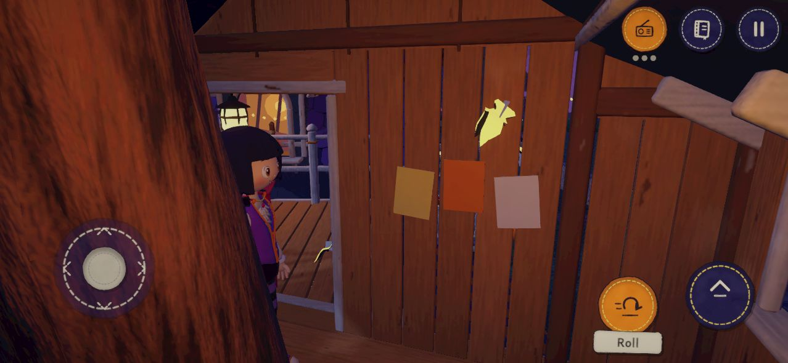
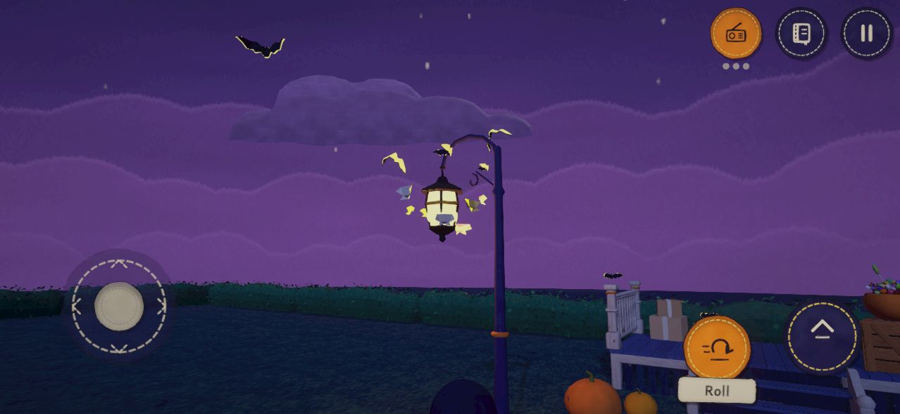
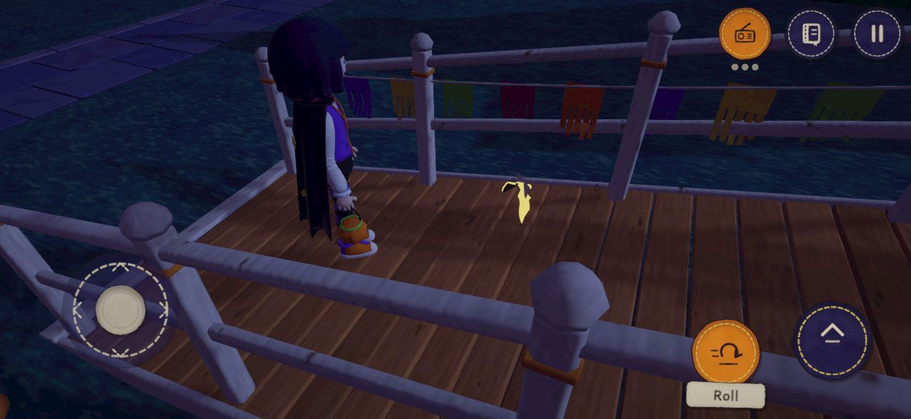
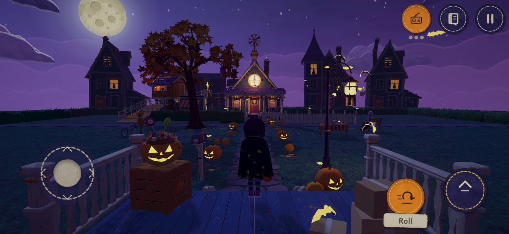

# S004 stream A1: keepsakes, the 30 paper bats (model and placement)

Branch `feature/s004-keepsakes`. Plan: `docs/S004-plan.md` §2.1 and §3 "Stream A" (A1 scope). A2 (notebook keepsakes
page, the bat mobile, the trunk and dress-up, the remark lines, the Continue count) is wave 2 and is not here.

## What A1 adds

- **Core (engine-free, C# 9), `Assets/SpookyStreet/Core/Keepsakes/`:**
  - `PaperBatLayout.cs`: the 30 spots (tier, area, move needed, safe anchor, bat centre, the surface it rests on,
    the top Pip takes it from, where its move starts) and the placement rules as functions: `InHiddenRegion`,
    `EyePoints`, `VisibleFrom` (hedges plus every exterior stage slab, sampled every 5 cm), `ClueMarks` and
    `NearestClue`, `InWorkshopNook`, `Rise` and `Reachable` (from the real `MovementTuningData`).
  - `Keepsakes.cs`: `KeepsakeState` (found bat IDs, worn piece IDs, said remark IDs; immutable) and `KeepsakeRules`.
    `Find` is idempotent, a found bat is never found twice, unknown IDs are ignored, and the result names the page it
    completed (1–3) exactly once, on the find that brings the count to 10, 20 or 30. Pages and pieces are derived from
    the count and never stored. Only earned pieces can be worn; a saved file can never wear more than it found.
  - `KeepsakeStore.cs`: `keepsakes.json` beside `street.json` and the case saves (the `StreetStore` pattern: atomic
    write, previous copy, recovery, a newer schema kept untouched until an explicit New game). Schema 1:
    `foundBats`, `wornPieces`, `saidRemarks`, all stable IDs; unknown IDs are dropped (a later street's bats can be
    added without a schema change), and the two later lists are optional.
  - `SketchPages.cs`, `CostumePieces.cs` (three slots, so all three can be worn), `CostumeRemarks.cs` (June on the
    cape, Mr. Vale on the pail, Aunt Kit on the hat after the stamp; IDs and the once-only rule `Due`; the lines,
    vignettes and voices are A2).
- **Strings:** three page captions (`keepsake.page.lanterns|friends|moon`) as one block at the end of `en.json`, with
  translator context, through `LocalizationKeys.Keepsakes`. Captions say what is drawn, never what it means. No other
  string: a find shows no text, number or pop-up.
- **World:** `Runtime/World/PaperBatCollectibles.cs`. Every unfound bat is in the world; it lies folded flat and,
  when Pip's chest is within 2.4 m, turns its face to her and tips up with a small flutter (none with reduced
  motion), showing a cream inner fold. Within 0.7 m of her chest it is taken: the paper dust puff
  (`MoveFeedback.Puff`), the paper peel sound (`AudioCues.StickerPick`), the bat leaves the world and the find is
  written at once. Pickup is off on the title, in cutscenes and while a modal is open. `Found` is raised with the
  page a find completed, for A2's single disc wobble.
- **Art swap point (stream B2):** `PaperBatCollectibles.KeepsakeModel = "KeepsakeBat"`. When
  `Resources/Models/Environment/KeepsakeBat.fbx` exists, each bat uses it (and its own flutter-open shape key
  replaces the greybox card). Until then the greybox is the decorative `PaperBat` mesh over a cream card, or two
  plain paper quads without models.
- **CaseDirector hooks (one line each):** create the bats with the street stage; load `keepsakes.json` after the
  street; New game asks first when keepsakes exist even with no case progress; a confirmed New game calls
  `Keepsakes.OnNewGame()`; a confirmed Replay calls `Keepsakes.OnReplay()` (keeps everything).

### New game (open decision 4)

The plan's recommendation (a), owner confirmation pending: a confirmed New game clears bats, pages and pieces, so every
bat is back in the world. It is one constant, `KeepsakeRules.NewGameClearsKeepsakes = true`, read only by
`KeepsakeRules.AfterNewGame`. Every test reads the constant, so flipping it to `false` keeps keepsakes across a New game
with no other change. Replay always keeps keepsakes (spec §4: bats never respawn).

## The 30 bats (as built)

Tiers: 10 loop (walk or tap jump only), 10 skilled, 10 challenge. IDs are place-keyed (`bat.lantern_lane.NN`), never
case-keyed. "Hidden" marks the side yard and treehouse region (`InHiddenRegion`: west of x −3.2 and north of the
side-yard hedges' south face, z 6.52), where no bat may be visible from the plaza, front-yard gate or bench eye.

| # | Tier | Area | Spot | Needs | Bat centre (x, y, z) | Anchor |
|---|---|---|---|---|---|---|
| 01 | loop | arrival porch | on the east rail's north post, the first thing in reach (opens as Pip arrives) | walk | 1.95, 1.72, −13.05 | arrival porch |
| 02 | loop | arrival porch | on the west rail's back post, behind the candy-bowl crate (1.65 m from the bowl) | walk | −1.95, 1.72, −14.95 | arrival porch |
| 03 | loop | plaza | among the party things on the table (the table's 1.0 m `TableThings` collider) | tap | 5.00, 1.12, −2.55 | plaza |
| 04 | loop | arrival path | at the street lamp's foot, plaza side | walk | 2.20, 0.12, −9.25 | arrival porch |
| 05 | loop | plaza south-west | in the fallen leaves between the path and Bea's corner | walk | −2.60, 0.12, −3.20 | bicycle corner |
| 06 | loop | bench corner | on the picket fence's east end post | tap | 9.00, 1.40, 5.00 | bench |
| 07 | loop | side yard (hidden) | on the ramp by its west skirt, facing in | walk | −13.10, 0.54, 9.50 | side yard |
| 08 | loop | treehouse (hidden) | under the cabin's roof beam, beside the door, inside | tap | −9.20, 3.75, 11.09 | treehouse |
| 09 | loop | attic loft | on a roof beam over the loft's front, away from the sill | tap | 0.80, 5.45, 59.40 | attic |
| 10 | loop | hall | on the coat hook by the stair foot | walk | −3.40, 1.55, 60.50 | foyer |
| 11 | skilled | side yard (hidden) | on the fixed crate of the skilled ascent | tap | −7.10, 0.72, 9.47 | side yard |
| 12 | skilled | side yard (hidden) | on the shed roof's west edge, behind the awning wall | tap (from the awning) | −7.65, 2.52, 12.00 | treehouse |
| 13 | skilled | front yard | on the front hedge's top, west of the gate | high jump | −2.60, 1.36, 5.00 | plaza |
| 14 | skilled | front yard | along the picket fence top | high jump | 4.80, 1.40, 5.00 | plaza |
| 15 | skilled | owl house | on the porch roof's west end, from the porch clutter | high jump | −2.80, 3.18, 9.00 | blue porch |
| 16 | skilled | owl house | on the low roof step's east side | high + tap | 2.00, 4.12, 12.50 | blue porch |
| 17 | skilled | bench corner | on the east boundary hedge's top | high jump | 21.45, 1.41, 1.00 | bench |
| 18 | skilled | arrival side | on the south boundary hedge's top behind the porch | high jump | −6.00, 1.41, −17.45 | arrival porch |
| 19 | skilled | owl house roof | on the ridge cap's back end | high jump | 0.00, 6.57, 16.50 | blue porch |
| 20 | skilled | treehouse (hidden) | on the cabin roof's north slope, facing away from the plaza | chain jump | −8.60, 4.63, 12.73 | treehouse |
| 21 | challenge | arrival path | on the street lamp's head | high jump + **ledge grab** (marked) | 2.75, 3.12, −9.55 | arrival porch |
| 22 | challenge | side yard (hidden) | in the air off the shed's west wall, above the yard pocket | **wall jump** (marked) | −8.85, 3.45, 14.75 | treehouse |
| 23 | challenge | front yard | in the air over the path, gliding off the porch roof | tap + **glide** | 0.00, 3.50, 6.50 | blue porch |
| 24 | challenge | side yard (hidden) | in the air behind the cabin, gliding off its roof toward the ramp | tap + **glide** | −11.20, 3.60, 13.60 | treehouse |
| 25 | challenge | owl house | on the porch roof's east end, chain-jumped from the deck | **chain jump** | 3.10, 3.09, 8.50 | blue porch |
| 26 | challenge | front yard east | in the air east of the house, gliding off the porch roof | tap + **glide** | 5.20, 3.50, 7.60 | blue porch |
| 27 | challenge | arrival path | in the air over the path, gliding off the lamp head | tap + **glide** | 2.90, 3.40, −7.40 | arrival porch |
| 28 | challenge | owl house roof | in the air east of the house, the long glide off the chimney | tap + **glide** | 6.50, 4.60, 15.00 | blue porch |
| 29 | challenge | arrival porch | in the air east of the porch, a held jump and glide off the rail | high jump + **glide** | 3.60, 3.50, −12.00 | arrival porch |
| 30 | challenge | owl house roof | on the chimney top, the block's highest point (7.4 m) | chain + high jumps | 1.50, 7.52, 15.45 | blue porch |

### Changes from the plan's table (the level is frozen, S003)

The plan's table is the authored intent; these spots needed geometry that case 01 does not have, so each moved to
the nearest real surface with the same kind of move:

- **No gate arch, neighbour awnings, stacked planters, porch-step lattice or treehouse flagpole exist.** 16 (east
  awning) became the owl house's low roof step, 18 (south-east porch roof) the south boundary hedge, 23 (gate-arch
  wall kicks) a glide off the porch roof, 25 (stacked planters) a chain jump onto the porch roof's east end, 26 (to
  the east awning) a glide east of the house, 30 (flagpole and its new ledge mark) the chimney top, the block's
  highest standable point. So **no new traversal mark was added**: `CollisionRules.TraversalMarks` is unchanged.
- **Roll and dive.** The roll does not shrink Pip's capsule and the glide out-reaches the dive, so no gap needs either
  move: 27 (roll) and 29 (dive) became glides (off the lamp head, and a held jump and glide off the arrival rail).
  A real roll or dive challenge needs a level change (owner's call).
- **The gate posts' wall kicks** never rise above a held jump (`docs/S003-wall-ledge.md`), so the only wall-jump bat
  is at the shed's marked west wall (22).
- **Hidden-region bats sit on inner faces:** 12 moved behind the awning wall (the awning's slope is in plain view of
  the plaza), 22 to the north end of the yard pocket behind the shed's west rail, 24 behind the cabin, 08 beside the
  cabin door (the door faces the plaza and the bench), 20 on the roof's north slope.
- **03** (maple low branch: the plaza maple has no collider below its 4.2 m fork) became the party things on the table, **04** sits
  at the lamp's foot on the path, **05** (west hedge end post: Bea's bicycle and the streamer are within 1.5 m)
  became the leaves by the path, **09** and **10** keep the plan's rooms.

## Placement rules (tested in Core, `PaperBatLayoutTests`)

1. **10 / 10 / 10.** Loop bats need only walk and tap and are never airborne; skilled bats need a jump but no marked
   surface or glide; challenge bats need a ledge grab, wall jump, glide or chain jump. All four appear.
2. **No bat marks a clue.** Every bat is at least 1.5 m (horizontal) from every Use target of the case (talk spots,
   bench, bicycle streamer, candy bowl decoy, owl booth, front door, cloth, sill, latch, workshop targets), the cloth
   itself and the wooden owl; a target 2 m or more above or below is on another floor (the sill above the hall bat).
   No bat in the workshop nook.
3. **No bat leads into a hidden answer.** Seven bats are in the side yard and treehouse region, and none is visible
   from the three eye points (child eye height 1.0 m at the plaza and at the front-yard gate, 1.07 m on the bench).
   The sight model blocks at the hedges (1.24 m) and inside every exterior stage slab (shed, ramp skirts and guards,
   cabin walls and roof, house body and roof steps). The picket fence counts as see-through. A sanity test checks the
   model sees open ground and is blocked behind the hedge, the shed and the house.
4. **Every bat is reachable with its move**, from the real tuning: a perched bat's top is within the move's rise of
   its launch (tap 0.9, held 2.0, chain 2.7, ledge grab 3.67 m) and the bat within the pickup of Pip standing there
   (chest 0.55 m + 0.7 m, plus a tap); a glide bat lies under the glide line (1.75 m/s fall at 4 m/s) from its launch
   apex; the kick bat lies within the kick's apex (1.2 m above the slide) and 1.6 m of the wall. Airborne bats float
   above what a held jump from the ground under them reaches, so they truly ask for their move. Bats on stage slabs
   are checked against the slab tops; the PlayMode test raycasts every perched bat onto its real collider.
5. **Challenges restart within 2 s** (8 m at walking speed) of their staged anchor; every anchor is staged and on
   the bat's side of the house shell. Challenges are all outside.
6. **Interior bats only in the attic loft and the hall**, both on the loop.
7. IDs unique and place-keyed; bats at least 1.5 m apart, inside the block, and clear of the six decorative bats.

`KeepsakeRulesTests` and `KeepsakeStoreTests` cover: pages and pieces at 10/20/30 exactly once in any order, only
earned pages and pieces listed (no empty slots), never respawn and idempotent finds, Replay keeps, New game per the
decision-4 constant, only earned pieces worn, each remark once with Kit's after the stamp, unknown and duplicate IDs
dropped, codec round trip, an interruption at every write step (no earlier bat lost), recovery from the previous
copy, a newer file kept until New game, Replay and the case save never touching the file, and a lint that no keepsake
string and no string that counts bats states a total ("x / 30", "x of 30").

## PlayMode and capture tests

- `KeepsakePlayTests`: walking into bat 04 (stick input) takes it, it fluttered open on the way, it leaves the world,
  `keepsakes.json` has it at once and a scene reload keeps it taken; a confirmed New game clears keepsakes (and New
  game asks first when only keepsakes exist); a confirmed Replay keeps them, on disk and after a reload; every perched
  bat rests on a real collider (downward raycast within 0.12 m of its `SitY`).
- `KeepsakeCaptureTests` (stream A's reserved number 65; 66–68 stay for A2's keepsakes page, trunk and title):
  `65d_bat_porch_start`, `65_bat_treehouse_deck`, `65b_bat_lamp_head`, `65c_bat_side_yard_ramp`.

## Narrative bible checklist (keepsakes, A1)

No clue, testimony or case fact changes; bats stay 1.5 m from every clue and Use target, none is visible in the side
yard from the street, and they flutter only when Pip is already near (a perception, not a marker). No string states a
conclusion or a total. Bats are never hinted, never respawn, are never spent and never gate a clue. Saved progress
uses stable IDs only.

## Evidence

- Local (`./tools/check-local.sh`, after merging `origin/main` b097e6b): validate_project, meta check, actionlint,
  shellcheck, yamllint, Fastfile, core tests 675/675 (the 28 keepsake tests included), audio and l10n checks.
- CI history on this branch:
  - **Run 152** (382a238): Runtime compile error (`MoveFeedback` needed `using SpookyStreet.Player`). Fixed.
  - **Run 155** (9d95cef): EditMode all green, Visual 1/1 (keepsake frames), PlayMode 3/4 keepsake tests:
    `EveryPerchedBatRestsOnARealCollider` failed for bat 02 over the moving boxes. Frame 65 was blocked by the
    maple trunk (it stands inside the cabin) and 65c had Pip hiding the bat. All reframed.
  - **Run 160** (9a95dd0, with main merged): EditMode 715/715, Visual 18/18, PlayMode 141/142. The only failure was
    bat 02 again; the new column raycast showed no porch or box collider under it (only `Ground`, `GroundRing_*`).
    The box stack is cutscene dressing, so bat 02 moved to the west rail's back post (the same surface as bat 01,
    which passes).
  - **Final run:** RUN_PLACEHOLDER

### Frames (looked at)

| Frame | What it shows | Verdict |
|---|---|---|
|  65 | Inside the treehouse cabin: Pip by the door, the bat open on the wall beside the door, its yellow paper edge toward her | Reads as a bat that turned to Pip. Greybox: it looks like the decorative bats; the cream fold is too small to see at this size |
|  65b | The street lamp from the path: the folded bat on the head among the decorative bats circling the lantern | The collectible cannot be told from the decoration here. Needs B2's distinct bat (black with a cream fold) |
|  65c | The side-yard ramp from its east side: Pip on the ramp, the bat open on the deck boards by the west rail | Reads; seen edge-on, small |
|  65d | The play camera at the start: the arrival porch and the lane; a bat by the moving boxes (bat 02's old spot) | Fine composition; bat 02 has since moved to the west rail post |

Frame numbers: S003a pass (merged to main before this branch) also used 65–68 (`65_bea_shade_eyes` … `68_street_greeting_bea`).
The file names differ, so nothing is overwritten, but the numbers overlap; A2 should pick 66–68 names that do not clash,
or the orchestrator can renumber.

## Open issues

- Owner: confirm decision 4 (New game clears keepsakes); flipping is one constant.
- B2 art: `KeepsakeBat.fbx` replaces the greybox at the swap point above; its flutter-open shape key should drive
  `PaperBatCollectibles` opening (today the greybox tips up and spreads a cream card).
- A real roll or dive challenge, a flagpole ledge or a gate arch needs level changes (owner's call).
- Greybox readability (frames 65b, 65d): a collectible looks like the decorative glowing bats. B2's model must make
  keepsakes clearly different (black with the cream pencilled fold), or the decorative bats near the lamp should
  move.
- The moving boxes on the arrival porch have no collider in the raycast column (run 160), although they are built
  solid in `CaseCutscenes`. A2's trunk (a Use target on one box) should check this.
- Plan acceptance items left to A2: the 10th bat's disc wobble and page assembly, dress-up, a remark playing once,
  and the scripted-route PlayMode pickups on each challenge tier (A1 proves reachability in Core and the surfaces by
  raycast).
