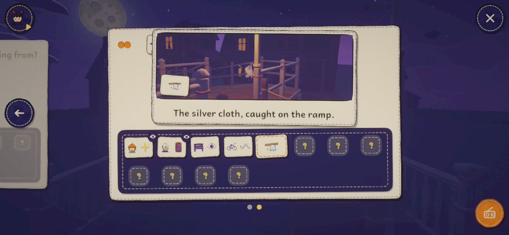
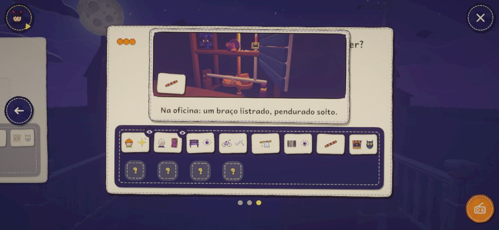
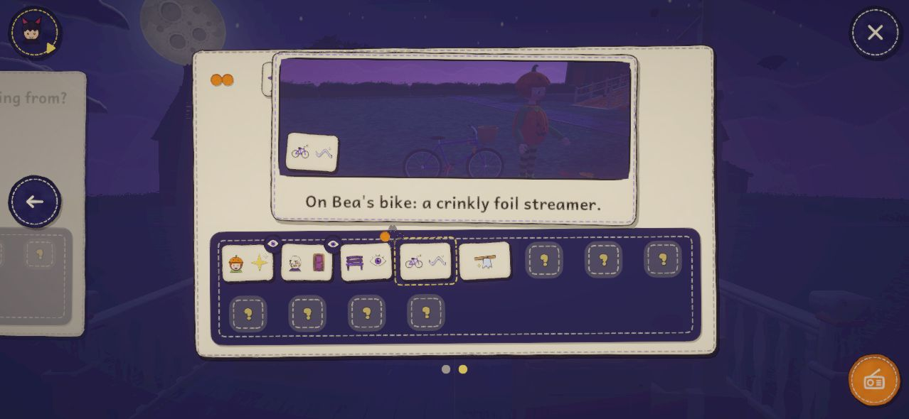
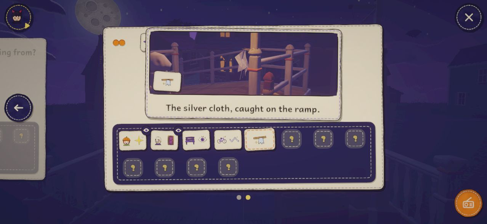
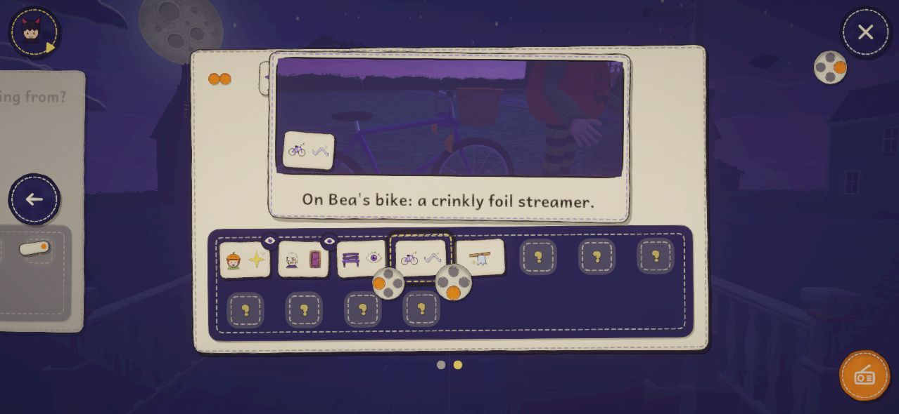

# S004: sticker memories in the notebook (D32)

Branch `feature/notebook-sticker-memory`. Not merged. Contract: owner decision D32 (2026-11-24, `docs/decisions.md`),
D26 (`docs/mystery-first.md`: the child makes the deductions), D25 (`docs/portability.md`, `docs/S004-ui-nav.md`), D30,
D31. Owner feedback from TestFlight build 52: "only from the drawing it's hard to understand what is there… I end up
guessing until I get it right".

## 1. What the child sees

Every sticker in the notebook tray can now show a small paper card with a short memory of the moment the child found
it: the real place in the game world, the camera drifting in slowly for 2.4 s, the sticker itself in the picture's
corner and one line under it ("The silver cloth, caught on the ramp."). The card holds the settled picture a little
over a second, then fades by itself (3.95 s in all). Pressing the card closes it at once.

- **Every sticker, the decoy included.** All 12 tray stickers have a memory (Bea's flash, Mr. Vale's door, the bench
  view, the stuck door, the foil streamer, the silver cloth, the sill thread, the floor hum, the wooden piece, the owl
  panel, the wooden owl, the loose arm). The streamer is treated exactly like the clues (D26 §2.7), so the memories
  never sort clues from non-clues. Bea's and Mr. Vale's stickers keep their eye for the full in-world replay.
- **The pictures are the reveal's sticker shots.** `C01Cutscenes.StickerShot` already framed each sticker's place
  for the reveal cutscene (proven in its CI frames); the memory reuses those poses and their drift (the small silver
  cloth has its own closer shot since §6.1), plus one new
  shot for the streamer (from the plaza side of Bea's bicycle), which the reveal never shows.
- **The world as the child saw it.** Each picture leaves Pip, June and Aunt Kit out (as the reveal does). Interior
  memories keep the house's rooms drawn while the card shows, and leave the sky dome out of their picture (it cuts
  through the interior). The door memories show the front door shut, the workshop ones look through the near wall
  as through the grille, for the instant of the picture only.
- **The memory look.** A paper card with a lilac stitch and a faint lilac tint over the picture, the colour of the
  in-world memory replays.
- **Recall, never meaning.** Each caption says what and where, never what it means or which question it answers.
- **Free to inspect.** Opening a memory never places a sticker, never counts a try and never records anything.
- **Reduced motion.** The card shows the settled frame as a still picture (drawn twice, then no more), with no pop and
  no fade: it cuts away at the end.

## 2. The gesture, and why

**A tap on a tray sticker lifts it (tap-tap, unchanged) and opens its memory; holding any sticker (0.45 s) opens its
memory without lifting it; a drag never opens it.**

- A child of 6 discovers it on the first tap, because the first thing every child does with a sticker is tap it.
  No new step is added to tap-tap: tap the sticker (its memory shows), then tap the slot. The card sits over the
  question and the slots and closes by itself, or at a press on it; the tray stays uncovered, so the lifted
  sticker is in view below the memory.
- It cannot be confused with placing, because a tap on a tray sticker never placed anything: it only ever lifted it.
  Placing still needs a second tap on a slot, or a drag.
- A drag is a sure gesture: a child who already knows where a sticker goes drags it, sees no card, and a card that
  was open closes as the drag starts, so the slots come into view for the drop.
- Holding is the "just look" gesture the owner named. It works on every sticker, including one sitting in a slot
  (where a tap still sends it home, the existing undo) and on solved pages. A hold is never a tap: the press that
  became a hold picks nothing up and sends nothing home.
- **Ruled out:**
  - Tap shows the memory, second tap on the same sticker lifts it. This adds a tap to every placement and breaks
    the tap-tap habit children already have.
  - Hold only. A 6-year-old would not find it, and the drawing-only problem would stay for most children.
  - A visible "eye" button on every sticker. It is too small at phone size, it would sit on 12 stickers at once,
    and it is a second target next to the one the child taps anyway.

**Gamepad and keyboard** use the shared navigation (`docs/S004-ui-nav.md`):

- South, Enter, Space or E lifts the ringed sticker and shows its memory, like a tap. A second press places it.
- A new **Inspect** action (gamepad West, keyboard F or I) shows the memory of the sticker under the outline, in the
  tray or in a slot, without lifting it. Pressing it again puts the memory away.
- Its glyph (the lit West button, or the F key cap) rides the outline's top-left corner while the outline rings a
  sticker; the Submit glyph of the accessibility pass rides the bottom-right corner. Touch shows no glyph.
- Back (East or Escape):
  - with a sticker lifted, it lets go of it and puts its memory away;
  - with only a memory open, it puts the memory away;
  - otherwise it closes the notebook.
- A cursor move, a page turn or a placement also puts the memory away.

## 3. Files

**Core (engine-free, C# 9):**

- `Core/Case/StickerMemories.cs`: `StickerMemory` (sticker, caption key, from and to poses, the world look),
  `StickerMemories` (the 12 memories, `Open(sticker, state)` reads only) and `StickerMemoryPlayback` (shot, hold,
  fade, reduced motion; the notebook's clock, so the pause freezes it).
- `Core/Case/DeductionCursor.cs`: `InspectTarget(board, tray)`, the sticker under the cursor. It only reads.
- `Core/Nonverbal/ControlGlyphs.cs`: `ControlPrompt.Inspect` (West, F).
- `Core/Localization/LocalizationKeys.StickerMemory.cs`: 12 captions (`c01.memory.*`) and the card's accessibility
  name.

**Runtime:**

- `Runtime/UI/StickerMemoryCard.cs`: the card and the `IStickerMemoryStage` interface.
- `Runtime/UI/NotebookView.Memory.cs`: a new partial for opening, closing, Inspect, the hold and the glyph.
- `Runtime/Case/StickerMemoryStage.cs`: the small on-request camera rendering into a 960×320 texture, as the
  cutaway's owl inset does.
- Small hooks in existing files:
  - `NotebookView.Deduction.cs`: the note on a tap opens the memory, a drag closes it, Back and Inspect in
    `TickInput`, a cursor move closes it, and the glyph tick.
  - `NotebookView.cs`: a page turn closes it (one line).
  - `NotebookSticker.cs`: the hold.
  - `GameInput.cs`: the `Inspect` action.
  - `NonverbalLayer.cs`: wires the stage (two lines).

**Strings:** 13 new keys in `en.json` and `pt-BR.json`, with identical translator context. No caption mentions Pip;
the Portuguese is in the plain register of the existing notes.

| Sticker | English | Português |
|---|---|---|
| Bea's flash | Bea, by her bike: a silver flash, up high. | Bea, perto da bicicleta: um brilho prateado, lá no alto. |
| Mr. Vale's door | Mr. Vale, on his bench: the front door stayed shut. | Sr. Vale, no banco: a porta da frente ficou fechada. |
| Bench view | From Mr. Vale's bench: the front door, and the hedge. | Do banco do Sr. Vale: a porta da frente e a cerca viva. |
| Stuck door | At the blue house: the front door won't budge. | Na casa azul: a porta da frente não se mexe. |
| Foil streamer | On Bea's bike: a crinkly foil streamer. | Na bicicleta da Bea: uma fita de alumínio. |
| Silver cloth | The silver cloth, caught on the ramp. | O pano prateado, preso na rampa. |
| Sill thread | A silver thread on the little attic window. | Um fio prateado na janelinha do sótão. |
| Floor hum | In the hall: the floorboards tremble with the knocks. | No corredor: as tábuas tremem com as batidas. |
| Wooden piece | Behind the grille: a wooden piece lifts up. | Atrás da grade: uma peça de madeira sobe. |
| Owl panel | In the workshop: an owl painted on the panel. | Na oficina: uma coruja pintada no painel. |
| Wooden owl | Above the front door: Kit's wooden owl. | Em cima da porta: a coruja de madeira da Tia Kit. |
| Loose arm | In the workshop: a striped arm, hanging loose. | Na oficina: um braço listrado, pendurado solto. |

The cloth caption is the owner's own example in D32. The tray-sticker tap used to put the sticker's note in the caption
strip; the card's caption now takes its place (the notes still play in the reveal).

## 4. Tests

- **Core** (`Tests/EditMode/Core/StickerMemoryTests.cs`, also run by `tools/core-tests`):
  - every tray sticker of case 01, the decoy included, has exactly one memory and a caption in en and pt-BR with
    identical context;
  - the captions describe and never conclude (English and Portuguese conclusion phrases, no June or cape, no fear
    words, no compass points, no control names, one short line);
  - each shot stands on the side of the house walls where its clue is found, looks at something near from a child's
    or witness's eye, and drifts gently;
  - the playback: a 2–3 s shot, then hold, then fade; the pause holds it; reduced motion is a still frame that cuts
    away;
  - inspecting every found sticker and every cursor position leaves the case facts, the board's slots, its try count
    and the held sticker unchanged, and placement works right after;
  - Inspect has its own glyph on every scheme, never a button or key of another notebook control.
- **PlayMode** (`Tests/PlayMode/StickerMemoryPlayTests.cs`):
  - `ATapOrAHoldShowsTheMemoryAndNeverPlaces`:
    - a tap lifts the sticker and opens its memory with its caption; nothing is placed, counted or recorded;
    - the card leaves the tray uncovered and closes by itself, and the world is given back;
    - tap-tap still places;
    - a hold on a tray sticker or on a placed one shows the memory without lifting it or sending it home;
    - a short tap on a placed sticker still sends it home;
    - a press on the card closes it, and an unfound clue has nothing to recall.
  - `DragAndTapTapStillPlaceAndSolveWithMemoriesAround`: a drag closes an open memory and places; tap-tap opens and
    closes it; the right set solves; a tap on a solved page shows a memory; closing the notebook gives the world back.
  - `GamepadAndKeyboardInspectWithTheirOwnGlyph`:
    - the West glyph rides the outline, West shows and hides the memory without lifting, East puts it away first;
    - South lifts (with its memory) and places;
    - Inspect on a slot sticker; F with its key cap;
    - reduced motion stops drawing after the still frame.
- **Updated:**
  - `CaseWiringTests` now checks that the tap on the bench sticker opens its memory (it used to check the note in the
    caption strip);
  - `UiNavigationTests.TheNavigationMapBindsWhatItsGlyphsShow` also covers Inspect.
- **Visual** (`Tests/Visual/StickerMemoryCaptureTests.cs`): frames 90–92 (§6).

## 5. CI evidence

**CI run 196** (`45479016132`, head c047770, `origin/main` c939735 already contained): all green.

| Results | Total | Passed | Failed |
|---|---|---|---|
| EditMode (Unity) | 876 | 876 | 0 |
| PlayMode | 165 | 165 | 0 |
| Visual | 24 | 24 | 0 |
| Core (`tools/core-tests`, local and the static job) | 811 | 811 | 0 |

New fixtures in that run:

- `StickerMemoryTests` 6/6
- `StickerMemoryPlayTests` 3/3
- `StickerMemoryCaptureTests` 1/1

Updated fixtures, also green: `CaseWiringTests`, `UiNavigationTests`, `DeductionNotebookTests` and `ControlGlyphsTests`.

**Earlier run on the branch.** Run 194 (`45467853469`, head e612407) compiled, and EditMode and PlayMode were all
green. The capture failed for two reasons:

- the frame numbers 82–84 were already taken by the keepsake captures;
- the card runs on real time, and one software-rendered CI frame outlasted the whole card, so the memory had closed
  before the capture.

The capture now uses frames 90–92, holds the notebook's clock and sets the card's time directly.

## 6. Frames (reviewed)

The frames are from run 196, in `docs/evidence/s004/sticker_memory/`. All three are 0.00 % magenta.

| Frame | Shows | Review |
|---|---|---|
|  90 | The silver cloth's memory after a tap, in English: the treehouse bridge-head post with the white scrap in the middle, the attic windows behind, the cloth sticker in the corner. Caption: "The silver cloth, caught on the ramp." | The place reads at once, and the lifted sticker shows below in the tray with its orange stitch. The card covers the question and the slots, never the tray. The scrap is small in the picture. |
|  91 | The loose arm's memory in Portuguese, drawn while Pip stands on the street: the workshop nook through the near wall, the striped arm across the frame. Caption: "Na oficina: um braço listrado, pendurado solto." | The interior memory works: the rooms are drawn and there is no sky wall. The caption fits on one line. |
|  92 | The decoy streamer's memory from Inspect on a gamepad: Bea beside her bicycle on the plaza. Caption: "On Bea's bike: a crinkly foil streamer." The outline rings the streamer sticker, nothing is lifted. | The decoy gets the same card as every clue. Two weaknesses: the foil itself barely reads (Bea fills the frame and the streamer is small on the bike), and the Inspect glyph at the outline's top-left corner is mostly hidden under the card's lower edge, with only the lit West button showing. |

Self-assessment: 4/5.

- The pictures make each sticker's place recognisable without reading, which was the owner's problem.
- Open points:
  - the streamer shot should be closer and lower on the bike (done, §6.1);
  - the Inspect glyph should move to a corner the card cannot cover, for example the outline's bottom-left (done by
    the living-street polish, frame 110);
  - small things (the cloth) could use a tighter field of view than the reveal's (done, §6.1).

### 6.1 Polish: the streamer and the cloth (branch `feature/case01-shot-polish`)

Camera data only (`StickerMemories.StreamerShot`, new `StickerMemories.ClothShot`); no art, caption, look, timing,
reduced-motion behaviour or case logic changed, and the reveal keeps its own cloth shot. Frames looked at:

| Frame | Shows | Review |
|---|---|---|
|  90 | The cloth's memory mid-drift: the silver scrap hanging off the bridge-head post fills the middle of the picture, the post and the rails around it. | The scrap now reads at phone size. Its own shot stands 1.6 m from it (field of view 20°, the rule's lower bound) instead of the reveal's 2 m at 27°. |
|  92 | The streamer's memory: low, at a child's eye height, on the bike's handlebar and basket in the middle, the bike around them, Bea's legs and hand at the side. | The bike is the subject and Bea is context. The foil moons and bats on their strings under the handlebar are still dark in the night light: better than before, not yet sparkling. |

The decoy rule (D26 §2.7) holds by test: `StickerMemoryTests.SmallThingsAreFramedCloseAndTheDecoyIsNeverFramedTighterThanAClue`
measures how much of the place each settled picture shows top to bottom and checks that the streamer's (0.58 m) is
never tighter than the tightest clue memory (the cloth, 0.56 m); the card, caption, lilac look and timing are the
same for every sticker. `StickerMemoryPlayTests.TheClothAndTheStreamerMemoriesShowTheirThingClose` checks the settled
memory camera on the spawned scrap, bike and Bea. Neither memory shows more than Pip saw there, and the reveal never
shows the streamer.

## 7. Known gaps

- The pictures are the world as it is now, framed as it was then for the door and the nook. Other state shows as it
  is now: the owl panel stands open once the grille was looked through, and the mechanism sits as it is after the
  test crank.
- No sound on opening a memory: there is no "memory" sound in the S003 set. The pick sound still plays on a tap.
- The final case card's sticker chips are not interactive (unchanged); the saved sweet has no memory (a keepsake,
  never in the tray).
